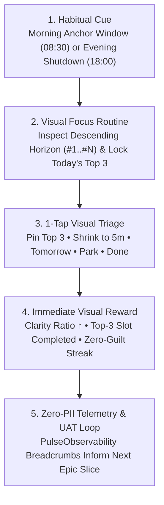

# Pulse — Epic Stream Roadmap, Prime Use Cases & Internal Agent Ticketing (Docs-as-Code)

> **Planning Governance (`AGENTS.md` §1)**:
> - **User-Facing Layer (Section 2 & Section 3)**: Product planning is presented to the user strictly as outcome-driven **Epic Streams (`EPIC-1`..`EPIC-5`)** with clear User Acceptance Testing (UAT) checkpoints.
> - **Visual Focus First (`v0.6.2`)**: The initial web & mobile focus commits **solely to the Visual Focus Dashboard** (`Horizon`, `Undone Log`, `Settings`). Conversational Partner Chat is intentionally deferred to `EPIC-5`.
> - **Agent-Internal Layer (Section 5)**: Low-level technical decomposition, class/API wiring, and test harnesses are self-organized by the engineering agent into compartmentalized technical tickets (`TKT-xxx`) so each slice can be reviewed and user-accepted independently.

---

## 1. Docs-as-Code Definition of Done & Test Pyramid Gate

Every compartmentalized increment (`v0.x.y` / Git commit) must pass all 5 mandatory gates before requesting User Acceptance:

1. **Test Pyramid Gate (Unit -> Integration/Contract -> E2E)**:
   - **Tier 1 (Pure Unit Tests)**: Backend JUnit 5 (`cd backend && ./gradlew test`), Web Vitest (`cd web && npm test`), and Android JUnit 4 (`./gradlew testDebugUnitTest`) cover 100% of pure domain, scarcity, contrast, and PII-scrubber functions.
   - **Tier 2 (Component & HTTP Contract Tests)**: Spring Boot `MockMvc` (`PulseControllerContractTest`), Android `MockWebServer` (`GoogleTasksSyncContractTest`), and Angular visual dashboard component/state specs verify JSON contracts, status codes (`200`, `400`, `401`, `403`, `404`), and UI state transitions.
   - **Tier 3 (Live E2E Runtime Verification)**: Verified against the live Angular 21 (`http://localhost:4200`) + Spring Boot 4 (`http://localhost:8080`) stack and/or Android targets (`emulator-5554` & `Pixel 8 Pro`).
2. **WCAG 2.2 AA Accessibility Gate**: Deterministic contrast ratio tests verify `>= 4.5:1` normal text and `>= 3.0:1` UI component contrast across Light and Dark schemes.
3. **Visual Focus Restraint Gate**: Zero chat FAB or chat drawer clutter on the initial Visual Focus Dashboard (`EPIC-1`).
4. **Prime Use Case & Zero-PII Telemetry Gate**: Validated against the Prime Use Cases below with structured zero-PII breadcrumbs (`PulseObservability`).
5. **Docs-as-Code Synchronization**: `README.md`, `docs/UX_FLOW_AND_DESIGN_SYSTEM.md`, `docs/SPRINT_ROADMAP_AND_USE_CASES.md`, `docs/CHANGELOG.md`, and `docs/tech-docs/*` updated in lockstep.

---

## 2. Executive Epic Streams (User-Facing Roadmap & UAT Checkpoints)

| Epic ID | Epic Stream | User Outcome & Value | Prime Use Cases | Current Status & User Acceptance Checkpoint |
| :--- | :--- | :--- | :--- | :--- |
| **`EPIC-1`** | **Visual Focus Dashboard & Top-3 Scarcity Experience** | Open Pulse to a calm, distraction-free **Visual Focus Dashboard**: 3 descending analytical Horizon windows (*Habitually Undone*, *Long-Standing Drift*, *Committed & Active Flow*), a synchronized Selected Task Inspector, a strict 3-slot **Today's Top 3** scarcity gate with swap dialog, and 1-tap `Undone Log` triage (*Pin Top 3*, *Shrink to 5m*, *Tomorrow*, *Park Someday*, *Done*)—with zero chat clutter. | `UC-1`, `UC-2` | **Ready for UAT (`v0.6.2`)** — Live on `http://localhost:4200` (Angular 21 + Spring Boot 4). All unit, contract, and E2E tests passing. |
| **`EPIC-2`** | **Frictionless Two-Way Google Tasks Sync** | Connect Google Tasks once and have every visual dashboard action (*Done*, *Shrink to 5m*, *Tomorrow*, *Park*) sync reliably back to Google Tasks API v1 with transparent status and error recovery. | `UC-3` | **Next Up (After `EPIC-1` UAT)** — Delivered in compartmentalized slices: OAuth connection, write-back queue, and diagnostic remediation banner. |
| **`EPIC-3`** | **Calm Multi-Page Customization & Privacy Diagnostics** | Configure ritual times, Google Tasks sync, and inspect live WCAG 2.2 AA contrast & zero-PII telemetry breadcrumbs across a clean 4-card Settings navigator. | `UC-4` | **Ready for UAT (`v0.6.2`)** — 4-card Settings Navigator & live WCAG/telemetry inspector verified on Web & Android. |
| **`EPIC-4`** | **App Stickiness, Daily Ritual Loops & Habitual Engagement Tie-Ins** | Build lasting daily engagement through behavioral habit loops: a 60-second **Morning Anchor Ritual** (locking Today's Top 3), an **Evening Honest Shutdown Ritual** (celebrating wins & triaging leftovers without guilt), **Implementation Intentions** (`"When [cue], I will start my 5m step"`), and zero-guilt **Consistency & Momentum Streaks** that pull the user back into the Visual Focus Dashboard every day. | `UC-5` | **Planned (Spec Complete in [`docs/tech-docs/STICKINESS_AND_HABITUAL_RITUAL_ARCHITECTURE.md`](tech-docs/STICKINESS_AND_HABITUAL_RITUAL_ARCHITECTURE.md))** — Ready to execute in compartmentalized slices. |
| **`EPIC-5`** | **Conversational Partner Chat & Live AI Coaching (Saved for Later)** | Optional reactive chat overlay and streaming AI coaching for talking through complex task blockers once the core Visual Focus Dashboard and Ritual Stickiness loops are established. | `UC-6` (Deferred) | **Saved for Later** — Intentionally decoupled and parked out of the active UI so `EPIC-1`..`EPIC-4` stay 100% focused on the visual dashboard and habitual stickiness. |

---

## 3. Prime Use Cases (Critical User Journeys)

| ID | Prime Use Case | User Goal & Trigger | Primary Surface & Components | Deterministic Acceptance Criteria (AC) |
| :--- | :--- | :--- | :--- | :--- |
| **UC-1** | **Single-Viewport Visual Horizon Assessment** | Immediately see task drift and today's focus on a single visual dashboard without scrolling cluttered tables or chat threads. | **Horizon** tab ([`app.component.ts`](../web/src/app/app.component.ts), [`AccountabilityHorizonCanvas.kt`](../app/src/main/java/com/pulse/accountability/ui/components/AccountabilityHorizonCanvas.kt)) | • Renders 3 analytical windows (*Habitually Undone*, *Long-Standing Drift*, *Committed & Active Flow*) in strict descending order (`#1`, `#2`, `#3`...). • Selecting any bar updates the **Selected Task Inspector** immediately. • Zero chat FAB or task-creation clutter. |
| **UC-2** | **Zero-Guilt Visual Triage & Top-3 Scarcity** | Rescue a chronically deferred (`2x+`) or idle (`5d+`) task in 1 tap from either the Horizon Inspector or `Undone Log`. | **Horizon Inspector** & **Undone Log** ([`stalled-task-card.component.ts`](../web/src/app/components/stalled-task-card/stalled-task-card.component.ts)) | • `ScarcityEngine` enforces a hard cap of `3` tasks in Today's Top 3 (prompting a swap modal on the 4th). • 1-tap visual actions (*Pin to Top 3*, *Shrink to 5m Starter*, *Tomorrow*, *Park Someday*, *Done ✓*) update state immediately and emit zero-PII breadcrumbs. |
| **UC-3** | **Frictionless Google Tasks Sync** | Keep the Visual Focus Dashboard and Google Tasks in lockstep. | **TopAppBar Sync** & **Settings -> Google Tasks Sync** | • Syncs task lists and queues write-back mutations with actionable remediation via `GoogleAuthDiagnostics`. |
| **UC-4** | **Calm Multi-Page Customization & Diagnostics** | Tune cadence windows, sync, and inspect privacy/accessibility health without a monolithic settings wall. | **Settings** tab ([`settings-navigator.component.ts`](../web/src/app/components/settings-navigator/settings-navigator.component.ts)) | • 4-card Settings index with dedicated sub-pages and explicit Back navigation. |
| **UC-5** | **Daily Ritual Stickiness & Habitual Engagement Loop** | Form a sticky daily habit of anchoring the morning in Top 3 priorities and closing open loops each evening. | **Morning Anchor Banner**, **Evening Shutdown Flow**, & **Momentum Strip** (`EPIC-4`) | • Pure `RitualGateRules` & `HabitStreakEngine` trigger Morning Anchor / Evening Shutdown states based on local time and configured ritual windows. • Tracks zero-guilt consistency streaks (`daysAnchoredThisWeek`) and 5-minute starter cue tie-ins. |

---

## 4. Closed-Loop Feedback & Stickiness Architecture

---

## 5. Agent-Internal Technical Ticketing Queue (Self-Managed Compartmentalized Parts)

> *Maintained internally by the engineering agent to deliver small, isolated, user-acceptable slices.*

### Epic Stream 1 (`EPIC-1`): Visual Focus Dashboard & Top-3 Scarcity Experience
- [x] **`TKT-101` (Backend Pure Domain & REST Contract)**: Java 21 `UndoneAccountabilityEngine`, `TaskVisualAnalyticsEngine`, `ScarcityEngine`, `TriageRules`, `WcagContrastEngine` + Spring Boot 4 `/api/v1/pulse` endpoints & JUnit 5 `MockMvc` contract suite.
- [x] **`TKT-102` (Pure Visual Focus Dashboard UI — Zero Chat Clutter)**: Angular 21 `AppComponent` & `StalledTaskCardComponent` focused 100% on the Top-3 Scarcity Strip, 3 descending Horizon windows, Selected Node Inspector with 5 direct visual triage buttons, `Undone Log`, and Top-3 Swap Modal.
- [x] **`TKT-103` (Full Test Pyramid Verification)**: Unit tests (JUnit 5 + Vitest + JUnit 4), HTTP/Component contract tests (`PulseControllerContractTest` + `pulse-visual-dashboard.spec.ts`), and live E2E verification on `http://localhost:4200`.

### Epic Stream 2 (`EPIC-2`): Frictionless Two-Way Google Tasks Sync
- [ ] **`TKT-201` (Two-Way Write-Back Client & Retry Queue)**: Queue `PATCH`/`POST` mutations to Google Tasks API v1 on completion, deferral, or 5m shrink with `MockWebServer` contract tests.
- [ ] **`TKT-202` (Web & Android OAuth Connection Diagnostics)**: Surface OAuth status and 1-click reconnect guidance via `GoogleAuthDiagnostics`.

### Epic Stream 3 (`EPIC-3`): Calm Multi-Page Customization & Privacy Diagnostics
- [x] **`TKT-301` (4-Card Categorized Settings Navigator)**: `SettingsNavigatorComponent` (Web) and `PartnerSettingsNavigator` (Android) with live WCAG 2.2 AA contrast & zero-PII breadcrumb inspector.

### Epic Stream 4 (`EPIC-4`): App Stickiness, Daily Ritual Loops & Habitual Engagement Tie-Ins
- [ ] **`TKT-401` (Pure `HabitualStickinessEngine` & `RitualGateRules` Port)**: Pure Java 21 & TypeScript engine computing active ritual state (`MORNING_ANCHOR_DUE`, `FOCUS_IN_FLOW`, `EVENING_SHUTDOWN_DUE`), weekly anchor consistency (`daysAnchored / 7`), and implementation-intention prompts (`"If-Then"` 5-minute starter cues).
- [ ] **`TKT-402` (Morning Anchor & Evening Honest Shutdown Visual Banner)**: Interactive ritual card at the top of the `Horizon` dashboard that guides locking in 3 tasks each morning and reviewing/closing open loops each evening.
- [ ] **`TKT-403` (Zero-Guilt Momentum Strip & Habit Cue Tie-Ins)**: Visual momentum indicator celebrating consecutive days of honest triage (completing, shrinking, or consciously parking stalled tasks) without punitive streak-breaking guilt.

### Epic Stream 5 (`EPIC-5` — Saved for Later): Conversational Partner Chat & Live AI Coaching
- [ ] **`TKT-501` (Re-enable Partner Chat Overlay & Live Streaming AI)**: Parked until `EPIC-1`..`EPIC-4` are user-accepted.
