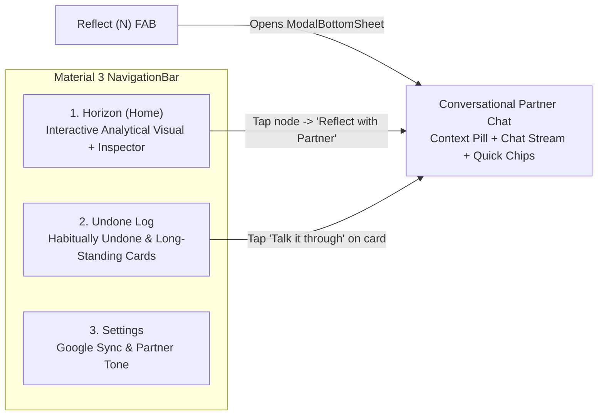

# Pulse UX Flow, Navigation & Accessibility Specification

## 1. Core Product Philosophy (MLP)
Pulse is a calm, candid **accountability partner for Google Tasks**—not a second task manager.
- **No Task-Creation Clutter**: Users already create tasks in Google Tasks. Pulse does not render a `"Commit Task"` FAB or duplicate task-entry forms.
- **No App-Name Vanity Branding**: The primary screen never wastes vertical real estate advertising `"Pulse • Accountability"`. Headers are compact, contextual, and quiet.
- **Interactive Visual Primary + Conversational Partner via FAB**: The main surface is a calming, analytical 2D task visualization (**Accountability Horizon**), while the warm conversational partner chat is routed through a dedicated **Reflect FAB** (`ExtendedFloatingActionButton`).

---

## 2. Information Architecture & Material 3 Navigation

Pulse uses a standard **Material 3 Bottom `NavigationBar`** with 3 destinations, a compact **Material 3 `TopAppBar`**, and a **Reflect Chat FAB**:

### TopAppBar Structure
- **Component**: Standard single-row Material 3 `TopAppBar` (`64.dp` height).
- **Title**: Contextual destination title only (`"Horizon"`, `"Undone Log"`, or `"Settings"`).
- **Trailing Action**: Single semantic `"Sync Google Tasks"` `IconButton` (`48.dp` target, `contentDescription = "Sync Google Tasks"`) on `Horizon` and `Undone Log`.

### Destination 1: `Horizon` (Primary Home Screen — Swipeable Analytical Window Carousel)
1. **Window Selector Chips + Swipeable Horizon Window Carousel (`AccountabilityHorizonCanvas.kt` + `TaskVisualAnalyticsEngine.kt`)**:
   - No top stat-box clutter and no duplicate task log below the fold.
   - Open tasks are partitioned into **3 swipeable `HorizontalPager` Window Cards**, each ordered in **strict descending order** (`#1`, `#2`, `#3`...):
     - **Window 1 — `Habitually Undone` (`Habitual`)**: Tasks deferred `2×+`, cascading in descending order of deferral count.
     - **Window 2 — `Long-Standing Drift` (`Drifting`)**: Tasks untouched for `5+` days or overdue, cascading in descending order of drift age.
     - **Window 3 — `Committed & Active Flow` (`Active`)**: Today's locked `Top 3` commitments first, then active tasks in descending order of age.
   - Tapping any descending bar row (or swiping to a new window) selects that task and updates the **Selected Node Inspector Card** immediately below.
2. **Selected Node Inspector Card**:
   - Displays full task title, analytical badges (`Habitually Undone` / `Long-Standing`, `Deferrals: N×`, `Age: Xd • Idle: Yd`), last reflection note, and 1-tap actions (`"Reflect with Partner"` or `"Done"`).

### Conversational Partner Chat (Routed Through the `Reflect` FAB via Swappable `PartnerChatOverlay`)
- Triggered from the bottom-right **`Reflect` Extended FAB** (or any `"Reflect with Partner"` / `"Talk it through"` button).
- Encapsulated in a standalone, swappable reactive component ([`PartnerChatComponent.kt`](file:///Users/stefan/Documents/antigravity/sharp-euclid/app/src/main/java/com/pulse/accountability/ui/components/chat/PartnerChatComponent.kt)) driven by a pure UI model (`PartnerChatUiModel` via `PartnerChatMapper.fromUiState(...)`) and a single event sink (`(PartnerChatEvent) -> Unit`):
  1. **Full-Viewport Reactive Surface**: Opens as a full-screen overlay with `TopAppBar` (`Close` button, `"Reflect"` title, and `"Next task"` switcher), `imePadding()`, and `rememberLazyListState()` auto-scrolling (`LaunchedEffect(model.messages.size)`).
  2. **Per-Task Thread Persistence (`conversationThreadsByTaskId`)**: Closing and reopening the `Reflect` FAB preserves your active conversation thread for each task.
  3. **Reusable Primitives**: Stalled task cards across `Horizon` and `Undone Log` share [`StalledTaskLogCard.kt`](file:///Users/stefan/Documents/antigravity/sharp-euclid/app/src/main/java/com/pulse/accountability/ui/components/StalledTaskLogCard.kt), and quick-reply chips are rendered from a data-driven `List<QuickReplySpec>`.

### Destination 2: `Undone Log` (Structured Cards-with-Bubbles Audit Trail)
- Renders individual task cards with status bubbles (`Deferred 4×`, `Habitually Undone`, `8d untouched`, last reflection note), followed by `Committed Today (Top 3)` and `Active Backlog`.

### Destination 3: `Settings` (Multi-Page Categorized Settings Navigator)
- Implemented in [`PartnerSettingsNavigator.kt`](file:///Users/stefan/Documents/antigravity/sharp-euclid/app/src/main/java/com/pulse/accountability/ui/screens/settings/PartnerSettingsNavigator.kt) (Android) and [`settings-navigator.component.ts`](file:///Users/stefan/Documents/antigravity/sharp-euclid/web/src/app/components/settings-navigator/settings-navigator.component.ts) (Angular 21) with animated/signal page transitions instead of a single crowded scroll page:
  - **Root Index (`SettingsSubPage.INDEX`)**: 4 clean category navigation cards (`Partner Persona & AI`, `Google Tasks Sync`, `Cadence & Rituals`, `Privacy & Diagnostics`).
  - **Dedicated Sub-Pages**: Each category opens its own focused single-purpose page with an explicit back header.

### Angular 21 + Spring Boot 4 Full-Stack Web Architecture (`web/` & `backend/`)
- **Angular 21 Standalone Signals SPA (`web/`)**:
  - [`app.component.ts`](file:///Users/stefan/Documents/antigravity/sharp-euclid/web/src/app/app.component.ts): Renders the compact `TopAppBar` (`64px`), Today's Top 3 Scarcity Strip, 3-Window Horizon selector (`Habitual`, `Drifting`, `Active`) with strict descending rank bars (`#1`, `#2`, `#3`...), Selected Node Inspector, bottom 3-tab `NavigationBar`, and `Reflect` Extended FAB.
  - [`partner-chat-overlay.component.ts`](file:///Users/stefan/Documents/antigravity/sharp-euclid/web/src/app/components/partner-chat/partner-chat-overlay.component.ts): Standalone reactive chat drawer preserving per-task reflection threads.
  - [`stalled-task-card.component.ts`](file:///Users/stefan/Documents/antigravity/sharp-euclid/web/src/app/components/stalled-task-card/stalled-task-card.component.ts): Reusable card component for the `Undone Log`.
- **Spring Boot 4.0.9 + Java 21 Backend (`backend/`)**:
  - Pure Java 21 domain engines ([`UndoneAccountabilityEngine.java`](file:///Users/stefan/Documents/antigravity/sharp-euclid/backend/src/main/java/com/pulse/backend/domain/UndoneAccountabilityEngine.java), [`TaskVisualAnalyticsEngine.java`](file:///Users/stefan/Documents/antigravity/sharp-euclid/backend/src/main/java/com/pulse/backend/domain/TaskVisualAnalyticsEngine.java), [`ScarcityEngine.java`](file:///Users/stefan/Documents/antigravity/sharp-euclid/backend/src/main/java/com/pulse/backend/domain/ScarcityEngine.java), [`TriageRules.java`](file:///Users/stefan/Documents/antigravity/sharp-euclid/backend/src/main/java/com/pulse/backend/domain/TriageRules.java), [`WcagContrastEngine.java`](file:///Users/stefan/Documents/antigravity/sharp-euclid/backend/src/main/java/com/pulse/backend/domain/WcagContrastEngine.java)) exposed via [`PulseController.java`](file:///Users/stefan/Documents/antigravity/sharp-euclid/backend/src/main/java/com/pulse/backend/api/PulseController.java) (`/api/v1/pulse`).

---

## 3. WCAG 2.2 Level AA Color Contrast & Accessibility Architecture

All color tokens in [`PulseExpressiveTheme.kt`](file:///Users/stefan/Documents/antigravity/sharp-euclid/app/src/main/java/com/pulse/accountability/ui/theme/PulseExpressiveTheme.kt) are governed by pure functional WCAG 2.2 contrast mathematics ([`WcagContrastEngine.kt`](file:///Users/stefan/Documents/antigravity/sharp-euclid/app/src/main/java/com/pulse/accountability/ui/theme/WcagContrastEngine.kt)) and verified in JUnit (`WcagContrastEngineTest`):

| Token Pair (Foreground / Background) | WCAG 2.2 AA Requirement | Light Scheme Ratio | Dark Scheme Ratio |
| :--- | :--- | :--- | :--- |
| `onBackground` / `background` | `>= 4.5:1` (SC 1.4.3) | `>= 14.0:1` | `>= 13.5:1` |
| `onSurface` / `surface` | `>= 4.5:1` (SC 1.4.3) | `>= 14.0:1` | `>= 13.5:1` |
| `onSurfaceVariant` / `surfaceContainerHigh` | `>= 4.5:1` (SC 1.4.3) | `>= 6.5:1` | `>= 7.0:1` |
| `onPrimary` / `primary` (Reflect FAB) | `>= 4.5:1` (SC 1.4.3) | `>= 8.5:1` | `>= 7.5:1` |
| `onPrimaryContainer` / `primaryContainer` | `>= 4.5:1` (SC 1.4.3) | `>= 11.0:1` | `>= 8.0:1` |
| `onSecondaryContainer` / `secondaryContainer` | `>= 4.5:1` (SC 1.4.3) | `>= 10.5:1` | `>= 7.5:1` |
| `onTertiaryContainer` / `tertiaryContainer` | `>= 4.5:1` (SC 1.4.3) | `>= 11.0:1` | `>= 7.5:1` |
| `onErrorContainer` / `errorContainer` | `>= 4.5:1` (SC 1.4.3) | `>= 10.0:1` | `>= 7.5:1` |
| `onError` / `error` | `>= 4.5:1` (SC 1.4.3) | `>= 5.5:1` | `>= 5.5:1` |
