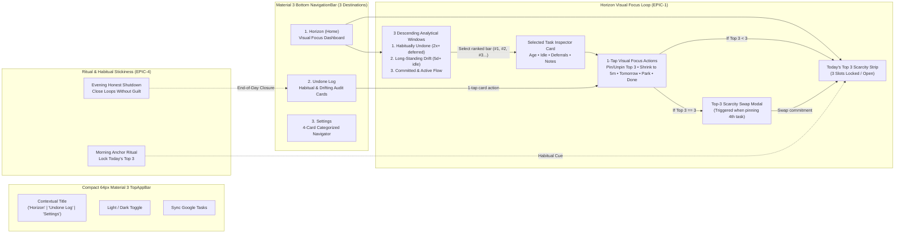

# Pulse UX Flow, Visual Focus Dashboard & Accessibility Specification

## 1. Core Product Philosophy (Shared KMP + Compose Multiplatform Visual Focus — `v0.6.4`)
Pulse is a calm, candid **visual accountability dashboard for Google Tasks**—not a second task manager:
- **100% Shared Compose Components & Domain (`commonMain` across Web `wasmJs` & Android)**: All UI components ([`AccountabilityHorizonCanvas.kt`](file:///Users/stefan/Documents/antigravity/sharp-euclid/app/src/main/java/com/pulse/accountability/ui/components/AccountabilityHorizonCanvas.kt), [`StalledTaskLogCard.kt`](file:///Users/stefan/Documents/antigravity/sharp-euclid/app/src/main/java/com/pulse/accountability/ui/components/StalledTaskLogCard.kt), [`PartnerSettingsNavigator.kt`](file:///Users/stefan/Documents/antigravity/sharp-euclid/app/src/main/java/com/pulse/accountability/ui/screens/settings/PartnerSettingsNavigator.kt), [`PulseExpressiveTheme.kt`](file:///Users/stefan/Documents/antigravity/sharp-euclid/app/src/main/java/com/pulse/accountability/ui/theme/PulseExpressiveTheme.kt)) and pure domain engines live in a single shared KMP codebase so zero UI or domain code is written twice.
- **Responsive Adaptive Layouts (Mobile `< 600.dp` vs. Web/Desktop `>= 840.dp`)**:
  - **Compact (`< 600.dp`, Mobile Portrait)**: Bottom Material 3 `NavigationBar` + single-column stacked Top-3 Scarcity Strip, 3-Window `HorizontalPager` Horizon Card, and Selected Task Inspector.
  - **Medium / Expanded (`>= 600.dp` / `>= 840.dp`, Tablet, Foldable & Web Browser)**: Side `NavigationRail` + 2-pane responsive split layout (Left pane: Top-3 Scarcity Strip + 3-Window `HorizontalPager` Horizon Card; Right pane: persistent Selected Task Inspector & 2-column `Undone Log` grid).
- **Multiplatform Firebase Dashboard Observability (`gw-cli-490302`)**: Shared [`PulseObservability.kt`](file:///Users/stefan/Documents/antigravity/sharp-euclid/app/src/main/java/com/pulse/accountability/observability/PulseObservability.kt) scrubs all PII in `commonMain` and dispatches live breadcrumbs, non-fatal diagnostics, and analytics events to the **Firebase Dashboard (`gw-cli-490302`)** on both Android (`FirebaseCrashlytics` + `FirebaseAnalytics`) and Web (`firebase-js-sdk` Analytics & error telemetry).
- **100% Visual Focus Dashboard First (`EPIC-1`)**: The active interface commits solely to visual clarity—partitioning tasks into 3 descending Horizon windows, enforcing a 3-slot Today's Top 3 scarcity gate, and providing 1-tap visual triage. Conversational Partner Chat is intentionally saved for a later milestone (`EPIC-5`) so zero chat FABs or drawers distract from visual focus.
- **No Task-Creation Clutter**: Users already create tasks in Google Tasks. Pulse never renders a `"Commit Task"` FAB or duplicate task-entry forms.
- **No App-Name Vanity Branding**: Primary screen headers never waste vertical real estate advertising `"Pulse • Accountability"`. Headers are compact (`64px` / `64.dp`), contextual (`"Horizon"`, `"Undone Log"`, `"Settings"`), and quiet.
- **Habitual & Ritual Stickiness (`EPIC-4`)**: Visual cues tie directly into the user's daily rhythm (**Morning Anchor** to lock in Today's Top 3 and **Evening Honest Shutdown** to celebrate completed work or consciously triage leftovers).

---

## 2. Information Architecture & Interaction Diagram (`v0.6.2`)

Pulse uses a standard **Material 3 Bottom `NavigationBar`** with 3 destinations and a compact **Material 3 `TopAppBar`**:

### TopAppBar Structure
- **Component**: Standard single-row Material 3 `TopAppBar` (`64px` / `64.dp` height).
- **Title**: Contextual destination title only (`"Horizon"`, `"Undone Log"`, or `"Settings"`).
- **Trailing Actions**: Theme toggle (`Light` / `Dark`) and semantic `"Sync Google Tasks"` button (`48px` minimum touch target, explicit `aria-label` / `contentDescription`).

### Destination 1: `Horizon` (Primary Visual Focus Dashboard)
1. **Today's Top 3 Scarcity Strip**:
   - Displays the 3 daily non-negotiable slots (`#1`, `#2`, `#3`) at the top of the viewport.
   - Tapping a filled slot selects that task in the Inspector below; attempting to pin a 4th task opens the **Top-3 Scarcity Swap Modal**.
2. **3-Window Analytical Selector + Descending Bar Card (`TaskVisualAnalyticsEngine`)**:
   - Open tasks are partitioned into **3 analytical Window Cards**, each ordered in **strict descending order** (`#1`, `#2`, `#3`...):
     - **Window 1 — `Habitually Undone` (`Habitual`)**: Tasks deferred `2×+`, cascading in descending order of deferral count.
     - **Window 2 — `Long-Standing Drift` (`Drifting`)**: Tasks untouched for `5+` days or overdue, cascading in descending order of drift age.
     - **Window 3 — `Committed & Active Flow` (`Active`)**: Today's locked `Top 3` commitments first, then active tasks in descending order of age.
   - Tapping any descending bar row selects that task and updates the **Selected Node Inspector Card** immediately below.
3. **Selected Node Inspector Card (Direct Visual Triage)**:
   - Displays full task title, analytical badge (`Deferred N×`, `Xd untouched`, `Committed Today`), age/idle/deferral metrics, and 5 direct 1-tap visual actions:
     - `Pin to Top 3` / `Unpin Top 3`
     - `Shrink to 5m Starter`
     - `Tomorrow`
     - `Park Someday`
     - `Done ✓`

### Destination 2: `Undone Log` (Structured Visual Audit Trail)
- Renders reusable [`StalledTaskCardComponent`](file:///Users/stefan/Documents/antigravity/sharp-euclid/web/src/app/components/stalled-task-card/stalled-task-card.component.ts) / [`StalledTaskLogCard.kt`](file:///Users/stefan/Documents/antigravity/sharp-euclid/app/src/main/java/com/pulse/accountability/ui/components/StalledTaskLogCard.kt) cards grouped by:
  1. `Habitually Undone (Deferred 2×+)`
  2. `Long-Standing Drift (5d+ Untouched / Overdue)`
  3. `Committed Today (Top 3)`
- Every card exposes the same 1-tap visual triage actions (`Pin to Top 3`, `Shrink to 5m`, `Tomorrow`, `Park Someday`, `Done ✓`).

### Destination 3: `Settings` (Multi-Page Categorized Settings Navigator)
- Implemented in [`settings-navigator.component.ts`](file:///Users/stefan/Documents/antigravity/sharp-euclid/web/src/app/components/settings-navigator/settings-navigator.component.ts) (Angular 21) and [`PartnerSettingsNavigator.kt`](file:///Users/stefan/Documents/antigravity/sharp-euclid/app/src/main/java/com/pulse/accountability/ui/screens/settings/PartnerSettingsNavigator.kt) (Android):
  - **Root Index (`SettingsSubPage.INDEX`)**: 4 clean category navigation cards (`Partner Persona & AI`, `Google Tasks Sync`, `Cadence & Rituals`, `Privacy & Diagnostics`).
  - **Dedicated Sub-Pages**: Each category opens its own focused single-purpose page with an explicit back header.

### Deferred Milestone (`EPIC-5`): Conversational Partner Chat
- The standalone reactive chat components ([`partner-chat-overlay.component.ts`](file:///Users/stefan/Documents/antigravity/sharp-euclid/web/src/app/components/partner-chat/partner-chat-overlay.component.ts) and [`PartnerChatComponent.kt`](file:///Users/stefan/Documents/antigravity/sharp-euclid/app/src/main/java/com/pulse/accountability/ui/components/chat/PartnerChatComponent.kt)) remain modular and decoupled in the codebase for `EPIC-5`, but are intentionally omitted from the active `v0.6.2` Visual Focus Dashboard.

---

## 3. WCAG 2.2 Level AA Color Contrast & Accessibility Architecture

All color tokens in [`styles.css`](file:///Users/stefan/Documents/antigravity/sharp-euclid/web/src/styles.css) and [`PulseExpressiveTheme.kt`](file:///Users/stefan/Documents/antigravity/sharp-euclid/app/src/main/java/com/pulse/accountability/ui/theme/PulseExpressiveTheme.kt) are governed by pure functional WCAG 2.2 contrast mathematics ([`WcagContrastEngine.java`](file:///Users/stefan/Documents/antigravity/sharp-euclid/backend/src/main/java/com/pulse/backend/domain/WcagContrastEngine.java), [`pulse-domain.engine.ts`](file:///Users/stefan/Documents/antigravity/sharp-euclid/web/src/app/domain/pulse-domain.engine.ts), [`WcagContrastEngine.kt`](file:///Users/stefan/Documents/antigravity/sharp-euclid/app/src/main/java/com/pulse/accountability/ui/theme/WcagContrastEngine.kt)) and verified in automated unit tests:

| Token Pair (Foreground / Background) | WCAG 2.2 AA Requirement | Light Scheme Ratio | Dark Scheme Ratio |
| :--- | :--- | :--- | :--- |
| `onBackground` / `background` | `>= 4.5:1` (SC 1.4.3) | `15.92:1` | `14.56:1` |
| `onSurface` / `surface` | `>= 4.5:1` (SC 1.4.3) | `15.92:1` | `14.56:1` |
| `onSurfaceVariant` / `surfaceContainerHigh` | `>= 4.5:1` (SC 1.4.3) | `8.74:1` | `9.21:1` |
| `onPrimary` / `primary` | `>= 4.5:1` (SC 1.4.3) | `9.11:1` | `10.31:1` |
| `onPrimaryContainer` / `primaryContainer` | `>= 4.5:1` (SC 1.4.3) | `13.42:1` | `8.64:1` |
| `onSecondaryContainer` / `secondaryContainer` | `>= 4.5:1` (SC 1.4.3) | `12.69:1` | `7.89:1` |
| `onTertiaryContainer` / `tertiaryContainer` | `>= 4.5:1` (SC 1.4.3) | `13.51:1` | `7.98:1` |
| `onErrorContainer` / `errorContainer` | `>= 4.5:1` (SC 1.4.3) | `11.61:1` | `7.79:1` |
| `onError` / `error` | `>= 4.5:1` (SC 1.4.3) | `5.74:1` | `9.62:1` |
