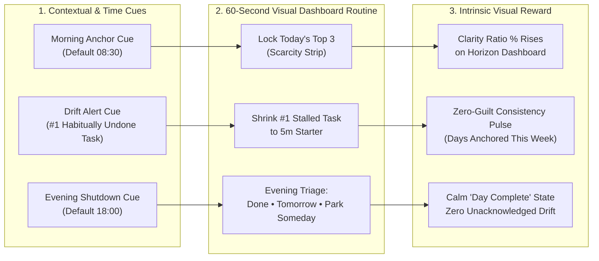

# Pulse — App Stickiness, Daily Ritual Loops & Habitual Engagement Architecture (`EPIC-4`)

> **Docs-as-Code Specification (`v0.6.2`)**: Defines the behavioral psychology, pure functional domain rules, and visual dashboard tie-ins for **`EPIC-4` (App Stickiness, Daily Ritual Loops & Habitual Engagement Tie-Ins)**.

---

## 1. Why Stickiness Matters for an Accountability Partner

Traditional task managers fail when a user's backlog grows stale: the sheer volume of overdue and deferred items triggers avoidance ("backlog bankruptcy"), causing the user to abandon the app.

Pulse solves this by pairing the **Visual Focus Dashboard (`EPIC-1`)** with lightweight, predictable **Habitual & Ritual Tie-Ins (`EPIC-4`)** grounded in behavioral design (Cue -> Routine -> Reward) and **Zero-Guilt Accountability**:
1. **Scarcity Reduces Overwhelm**: Locking in at most **3 tasks (`Today's Top 3`)** gives the user a finite, winnable daily game.
2. **5-Minute Starter Shrinking Beats Procrastination**: Shrinking a chronically deferred (`2x+`) task into a `5m starter` lowers activation energy so the user experiences an immediate win.
3. **Bookend Daily Rituals Create Automaticity**: Anchoring the morning (`08:30`) and closing open loops in the evening (`18:00`) turns opening the Visual Focus Dashboard into a reflexive daily habit.

---

## 2. The Habitual Engagement Loop (Cue -> Routine -> Reward)

---

## 3. Core Capabilities in `EPIC-4`

### 3.1 Morning Anchor Ritual (`RitualPhase.MORNING_ANCHOR`)
- **Trigger**: Active during the user's configured morning window (default `06:00–11:00` around the `08:30` anchor time in `Settings -> Cadence & Rituals`) whenever `top3Commitments.length < 3`.
- **Visual Tie-In on `Horizon`**:
  - Highlights the **Today's Top 3 Scarcity Strip** with a calm prompt: *"Morning Anchor: Lock in up to 3 realistic priorities before diving into your day."*
  - Suggests rescuing at least **1 task** from Window 1 (*Habitually Undone*) or Window 2 (*Long-Standing Drift*) by shrinking it to a `5m starter`.

### 3.2 Implementation Intentions (`"If-Then"` Habit Tie-In)
- **Trigger**: When pinning a chronically deferred task (`deferCount >= 2`) or shrinking it to a `5m starter`.
- **Visual Tie-In**:
  - Allows attaching a 1-tap habitual cue tag (`After morning coffee`, `Before opening email`, `Right after lunch`, `Last 15m of workday`) so the commitment is tied to a real-world routine trigger.

### 3.3 Evening Honest Shutdown Ritual (`RitualPhase.EVENING_SHUTDOWN`)
- **Trigger**: Active during the user's configured evening window (default `17:00–22:00` around the `18:00` shutdown time) when any `Today's Top 3` tasks remain open.
- **Visual Tie-In on `Horizon` & `Undone Log`**:
  - Guides a 30-second end-of-day sweep: mark finished Top-3 tasks `Done ✓`, or consciously move unfinished items to `Tomorrow` or `Park Someday` so the user ends the day with zero lingering guilt.

### 3.4 Zero-Guilt Consistency & Momentum Pulse
- **Why Standard Streaks Fail**: Punitive streaks reset to `0` after a single missed day, causing users to quit permanently ("what-the-hell effect").
- **Pulse's Rolling 7-Day Consistency Meter**:
  - Measures **Rolling Weekly Anchor Days (`0..7 days active in last 7 days`)** and **Rescued Stalled Tasks Count** (tasks with `deferCount >= 2` or `daysUntouched >= 5` that were either completed, shrunk to 5m, or consciously parked).
  - Never punishes a rest day; every single visual triage action immediately increments momentum.

---

## 4. Pure Functional Domain Specification (`ADR-007`)

All `EPIC-4` logic is governed by pure, stateless functions (`RitualGateRules` & `HabitualStickinessEngine`) with 100% deterministic unit test coverage:

| Pure Function | Inputs | Deterministic Output |
| :--- | :--- | :--- |
| `evaluateRitualPhase(nowTime, settings, top3Count)` | `LocalTime`, `PartnerSettingsDto`, `int` | `MORNING_ANCHOR_DUE`, `MIDDAY_FOCUS_FLOW`, `EVENING_SHUTDOWN_DUE`, or `DAY_COMPLETE` |
| `computeRollingConsistency(activityDates, today)` | `Set<LocalDate>`, `LocalDate` | Rolling 7-day consistency count (`0..7`) + momentum badge (`"Building Rhythm"`, `"Steady Flow"`, `"Locked In"`) |
| `suggestHabitRescueCandidate(horizonSnapshot)` | `TaskHorizonAnalyticsSnapshot` | Returns the `#1` highest-friction task from `HABITUALLY_UNDONE` or `LONG_STANDING_DRIFT` for 1-tap `Shrink to 5m` rescue |

---

## 5. Deterministic Acceptance Criteria for `EPIC-4` UAT

1. **Pure Unit Gate**: 100% JUnit 5 (Spring Boot) and Vitest (Angular 21) coverage of `evaluateRitualPhase`, `computeRollingConsistency`, and `suggestHabitRescueCandidate`.
2. **Visual Integration**: Morning Anchor and Evening Shutdown banners integrate directly into the `Horizon` Visual Focus Dashboard without adding modal popups or chat clutter.
3. **Settings Synchronization**: Changing Morning Anchor or Evening Shutdown times in `Settings -> Cadence & Rituals` immediately updates the active ritual phase on the `Horizon` dashboard.
4. **Zero-PII Telemetry**: Ritual completions emit `PulseObservability.recordBreadcrumb("ritual_completed", ...)` with zero task titles or PII.
