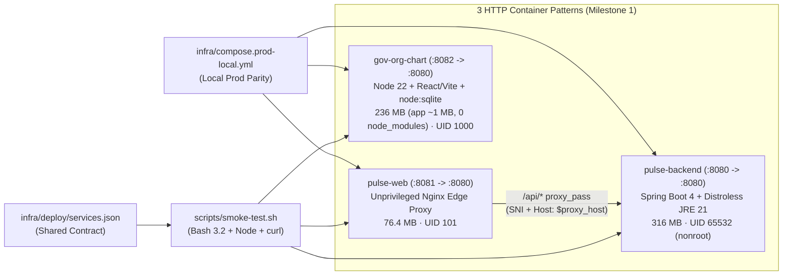
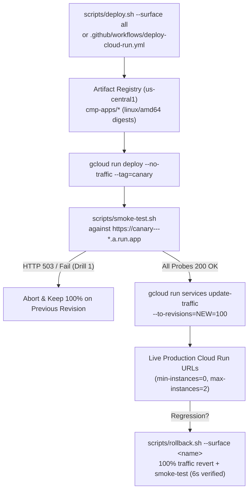

# Single-Command Production Deployment & Rollback Playbook (RFC-0002)

> **Purpose:** A permanent, hands-on engineering reference for taking monorepo applications from local development to containerized, probe-verified, zero-downtime production rollouts and sub-10-second rollbacks — built incrementally across two milestones.

- **Current Status:** **Milestones 1 & 2 Complete & Verified Live** (Local multi-stage containers, 12-factor config, liveness/readiness probes, single-command Cloud Run deployment + instant rollback in `gw-cli-490302`, canary bad-deploy block, `6s` live rollback drill, SHA-pinned CI workflow, and [`ADR-0004`](../adr/0004-single-command-cloud-run-deploy-and-rollback.md)).

---

## 1. Architecture Overview Across All Surfaces

Instead of forcing every tech stack into one generic container shape, this repository demonstrates **three canonical production container patterns** wired together by a single declarative manifest ([`infra/deploy/services.json`](../../infra/deploy/services.json)) and verified by one cross-surface smoke gate ([`scripts/smoke-test.sh`](../../scripts/smoke-test.sh)):



### All-Surfaces Deployment Matrix

| Surface | Path | Runtime Pattern | Measured Image Size (`docker images`) | Liveness Probe | Readiness Probe | Info / Revision Endpoint |
|---|---|---|---|---|---|---|
| **`pulse-backend`** | [`apps/pulse/backend`](../../apps/pulse/backend) | Distroless Java 21 API | `316 MB` | `GET /actuator/health/liveness` | `GET /actuator/health/readiness` | `GET /actuator/info` (`app.revision`) |
| **`pulse-web`** | [`apps/pulse/web`](../../apps/pulse/web) | Unprivileged Nginx SPA + `/api/` Edge Proxy | `76.4 MB` | `GET /livez` | `GET /readyz` | `GET /version.json` (`revision`) |
| **`gov-org-chart`** | [`apps/gov-org-chart`](../../apps/gov-org-chart) | Single-Container Node 22 Full-Stack BFF (`node:sqlite`) | `236 MB` (~1 MB app, `node:22-alpine` base, `0` runtime `node_modules`) | `GET /api/health` | `GET /api/ready` | `GET /api/info` (`revision`) |
| **`pulse-android`** | [`apps/pulse/app`](../../apps/pulse/app) | Native Android Compose client | N/A (APK/AAB) | — | — | Firebase App Distribution → Play Internal (`STE-42`) |
| **`pulse-kmp`** | [`apps/pulse/kmp`](../../apps/pulse/kmp) | KMP pure domain core + `wasmJs` bundle | N/A (Library/Wasm) | — | — | Consumed by Android / Web surfaces |
| **`ytm-menubar`** | [`apps/ytm-menubar`](../../apps/ytm-menubar) | Native macOS SwiftPM binary (`EXP-004` parked) | N/A (macOS `.app`/bin) | — | — | Local desktop build |

---

## 2. Milestone 1 Deep Dive (What Was Built & Why)

### 2.1 Multi-Stage & Distroless Containers

Every HTTP surface uses a **2-stage Docker build**: heavy SDKs (`eclipse-temurin:21-jdk-jammy`, `node:20-alpine`, `node:22-alpine` with build tools) stay in **Stage 1 (`builder`)**, while **Stage 2 (`runtime`)** copies only compiled runtime artifacts and drops privileges to a non-root user.

1. **`pulse-backend` — Distroless JRE (`316 MB`, zero shell)**:
   - See [`apps/pulse/backend/Dockerfile`](../../apps/pulse/backend/Dockerfile) and [`apps/pulse/backend/docker/HttpHealthProbe.java`](../../apps/pulse/backend/docker/HttpHealthProbe.java).
   - **Why `HttpHealthProbe.class` exists:** `gcr.io/distroless/java21-debian12:nonroot` strips `bash`, `sh`, `curl`, and `wget` to eliminate shell-injection attack surface. A shell-based `HEALTHCHECK CMD curl ...` would fail immediately. Compiling a 1.5 KB pure-JDK `java.net.http.HttpClient` probe in Stage 1 gives Docker Compose a native healthcheck with zero extra packages.
   - **Why `docker/HttpHealthProbe.java` lives outside `src/main/java`:** `apps/pulse/backend` enforces strict `ADR-007` domain purity (`ArchitectureTest`), Pitest mutation checks, and `-Xlint:all`. Keeping Docker probe tooling in `docker/` keeps application test scopes clean.
   - **Dependency layer caching:** Copying `gradlew`, `gradle/`, `settings.gradle.kts`, and `build.gradle.kts` *before* `COPY src ./src` caches downloaded Maven dependencies across Java edits.

2. **`pulse-web` — Unprivileged Nginx (`76.4 MB`, UID `101`)**:
   - See [`apps/pulse/web/Dockerfile`](../../apps/pulse/web/Dockerfile).
   - Stage 1 builds the AOT Angular 21 bundle (`npm run build`), which `@angular/build:application` emits into **`dist/pulse-web/browser/`** (not `dist/pulse-web/`).
   - Stage 2 uses `nginxinc/nginx-unprivileged:1.27-alpine` (`USER 101`), binding to unprivileged port `8080` (configurable via `PORT`) instead of privileged port `80`.

3. **`gov-org-chart` — Zero-`node_modules` Node 22 Full-Stack BFF (`236 MB` total, ~`1 MB` app payload)**:
   - See [`apps/gov-org-chart/Dockerfile`](../../apps/gov-org-chart/Dockerfile) and [`apps/gov-org-chart/server/index.ts`](../../apps/gov-org-chart/server/index.ts).
   - Because `server/` uses only Node 22 built-ins (`node:http`, `node:sqlite`, `node:fs`, `node:path`), Stage 2 copies **zero `node_modules`** — only `package.json`, `dist/client`, and `dist/server` (~508 kB combined). Nearly the entire `236 MB` virtual size is the `node:22-alpine` base image itself (documented via `docker history`).
   - Runs as `USER node` (UID `1000`) with a pre-created `/tmp/gov-data` directory for ephemeral SQLite WAL files (`GOV_DB_PATH`).
   - Serves static `dist/client` assets with strict `..` / `%2F` path-traversal rejection (`403`) and SPA route fallback while keeping unknown `/api/*` paths returning JSON `404`.

> **Platform Architecture Trap (Important for Milestone 2):** Local builds on Apple Silicon Macs produce `linux/arm64` images by default. Google Cloud Run requires `linux/amd64`, so Milestone 2 will use `docker buildx build --platform linux/amd64` (or Cloud Build) when pushing images to Artifact Registry.

---

### 2.2 12-Factor Config & Nginx Edge Proxy Pitfalls

All three containers run the **exact same image** locally and in staging/production; behavior changes strictly through environment variables:

| Variable | Consumed By | Local Default | Production / Cloud Run Role |
|---|---|---|---|
| `PORT` | All 3 surfaces | `8080` | Injected dynamically by Cloud Run (`$PORT`) |
| `K_REVISION` / `APP_REVISION` | All 3 surfaces | `local` / `local-m1` | Rendered in `/actuator/info`, `/version.json`, `/api/info` for deployment verification & rollback audits (`K_REVISION` takes precedence) |
| `APP_ENV` | All 3 surfaces | `local` | Environment label (`local-prod-parity`, `staging`, `prod`) |
| `CORS_ALLOWED_ORIGINS` | `pulse-backend` | `http://localhost:*,http://127.0.0.1:*` | Comma-separated origins parsed in [`WebCorsConfig.java`](../../apps/pulse/backend/src/main/java/com/pulse/backend/config/WebCorsConfig.java) |
| `API_UPSTREAM_URL` | `pulse-web` | `http://pulse-backend:8080` | Compose service DNS locally; backend `https://...run.app` URL in Cloud Run |
| `GOV_DB_PATH` | `gov-org-chart` | `server/../.data/gov.sqlite` | `/tmp/gov-data/gov.sqlite` inside ephemeral container storage |
| `GOV_DISABLE_STARTUP_SYNC` | `gov-org-chart` | `false` | Optional `true` flag in [`scheduler.ts`](../../apps/gov-org-chart/server/scheduler.ts) to skip startup remote fetches during offline drills |

#### Three Nginx Production Traps Solved in [`apps/pulse/web/nginx/`](../../apps/pulse/web/nginx/)

1. **`.envsh` vs `.sh` entrypoint hook ([`15-runtime-meta.envsh`](../../apps/pulse/web/nginx/15-runtime-meta.envsh)):**
   Nginx's `/docker-entrypoint.sh` **sources** `*.envsh` scripts (`. script.envsh`) so exported variables stay in the shell environment for `20-envsubst-on-templates.sh`. A `*.sh` script runs in a subshell and any `export` inside it disappears before `envsubst` runs.
2. **Restricting `envsubst` (`NGINX_ENVSUBST_FILTER`):**
   Without `NGINX_ENVSUBST_FILTER`, `envsubst` can accidentally erase Nginx runtime variables like `$uri` or `$proxy_host`. Setting `NGINX_ENVSUBST_FILTER` restricts substitution exclusively to `${PORT}`, `${API_UPSTREAM_URL}`, `${APP_REVISION}`, `${APP_VERSION}`, `${APP_ENV}`, `${READY_STATUS_CODE}`, and `${READY_STATUS_TEXT}`.
3. **`proxy_pass` trailing slash + Cloud Run TLS SNI & `Host` ([`default.conf.template`](../../apps/pulse/web/nginx/default.conf.template)):**
   - Writing `proxy_pass ${API_UPSTREAM_URL};` (**no trailing `/`**) preserves the full `/api/v1/pulse/...` path. A trailing slash would strip `/api/` and cause Spring Boot `404`s.
   - Adding `proxy_ssl_server_name on;` and `proxy_set_header Host $proxy_host;` is mandatory when proxying to HTTPS Cloud Run services (Google Front End rejects missing SNI or mismatched frontend `Host` headers with `404`).

---

### 2.3 Liveness vs. Readiness Probes & Graceful `SIGTERM` Shutdown

| Probe Question | Liveness | Readiness |
|---|---|---|
| **What it asks** | *"Is the process wedged and in need of a hard restart?"* | *"Should the load balancer send user traffic to this container right now?"* |
| **Behavior on failure** | Orchestrator kills & restarts the container | Orchestrator **removes the container from traffic rotation** (no crash loop, no dropped user requests) |
| **`pulse-backend`** | `GET /actuator/health/liveness` (`livenessState` only) | `GET /actuator/health/readiness` (`readinessState` + `deploymentDrill`) |
| **`pulse-web`** | `GET /livez` | `GET /readyz` |
| **`gov-org-chart`** | `GET /api/health` | `GET /api/ready` (also executes `SELECT 1 AS ok` against SQLite) |

#### Spring Boot 4.1.2 Package Note (Verified Against Local Gradle Cache)
In Spring Boot `4.1.2`, `Health` and `HealthIndicator` moved out of `org.springframework.boot.actuate.health.*` into **`org.springframework.boot.health.contributor.{Health, HealthIndicator}`** (see [`DeploymentDrillHealthIndicator.java`](../../apps/pulse/backend/src/main/java/com/pulse/backend/config/DeploymentDrillHealthIndicator.java)), and Kubernetes/Cloud Run availability state indicators require explicit opt-in in [`application.yml`](../../apps/pulse/backend/src/main/resources/application.yml):
- `management.health.livenessstate.enabled: true`
- `management.health.readinessstate.enabled: true`
- `management.info.env.enabled: true` (to render `info.app.*` at `/actuator/info`)

#### Graceful `SIGTERM` Connection Draining
- Every `Dockerfile` uses **exec-form** `ENTRYPOINT ["..."]` (JSON array) rather than shell-form (`ENTRYPOINT cmd`). Shell-form spawns `/bin/sh -c` as PID 1, which often swallows `SIGTERM` and causes a hard `SIGKILL` after timeout, dropping in-flight HTTP requests.
- With exec-form:
  - **Spring Boot (`pulse-backend`):** receives `SIGTERM` as PID 1, runs `server.shutdown: graceful` (`20s` drain timeout), logs `Graceful shutdown complete`, and exits cleanly.
  - **Node 22 (`gov-org-chart`):** catches `SIGTERM`/`SIGINT`, runs `server.close()` (`15s` force timeout), closes SQLite cleanly via `closeDb()`, and exits `0`.

---

### 2.4 Stateless-First Now vs. Phase 2 Postgres + Flyway Migrations

- **Milestone 1–2 (Stateless / Ephemeral):**
  - `pulse-backend` holds demo state in memory, and `gov-org-chart` writes its cached SQLite file to `/tmp/gov-data/gov.sqlite` inside container memory/ephemeral disk.
  - Why this is deliberate: Cloud Run instances scale to zero and spin up fresh containers per revision, so stateless services deploy and roll back in seconds with zero database migration risk while learning the deployment/rollback loop.
- **Phase 2 (Managed Postgres + Expand-and-Contract Migrations):**
  - When adding Cloud SQL / Neon Postgres, old (`rev N-1`) and new (`rev N`) containers serve traffic simultaneously during rolling updates and rollbacks.
  - Use **expand-and-contract** Flyway migrations: add nullable columns first (`V2__expand.sql`), deploy code writing both shapes, then drop legacy columns only after `rev N-1` is completely retired — never break backward compatibility in a single migration if you still expect `<10s` traffic rollback to `rev N-1`.

---

## 3. Milestone 1 Hands-On Labs (Try It Yourself)

Run these labs from the monorepo root (`/Users/stefan/Code/monorepo`) to observe every concept directly.

### Lab 1A — Build & Inspect Multi-Stage Image Sizes & Layers

```bash
docker compose -f infra/compose.prod-local.yml build
docker images --format "table {{.Repository}}:{{.Tag}}\t{{.Size}}" | grep "cmp/"
docker history cmp/gov-org-chart:local
docker history cmp/pulse-backend:local
```

**What to look for:**
- `cmp/pulse-web:local` (`76.4MB`) contains no Node.js or `node_modules` — only Nginx + compiled Angular assets.
- `cmp/pulse-backend:local` (`316MB`) rejects `docker run --rm --entrypoint sh cmp/pulse-backend:local` because distroless has no shell.
- `cmp/gov-org-chart:local` (`236MB`) has ~1 MB of app code (`dist/client` + `dist/server`) and zero `node_modules`.

### Lab 1B — Boot the Local Production-Parity Stack & Run the Smoke Gate

```bash
APP_REVISION=lab-v1 docker compose -f infra/compose.prod-local.yml up -d --wait
docker compose -f infra/compose.prod-local.yml ps
/bin/bash scripts/smoke-test.sh --surface all-local --expect-revision lab-v1
```

Try opening both web surfaces in your browser while the stack is running:
- `pulse-web` (Angular 21 via Nginx proxying `/api/` -> `pulse-backend`): <http://127.0.0.1:8081>
- `gov-org-chart` (React SPA + Node 22 + SQLite): <http://127.0.0.1:8082>
- Inspect revision metadata directly:
  ```bash
  curl -s http://127.0.0.1:8080/actuator/info
  curl -s http://127.0.0.1:8081/version.json
  curl -s http://127.0.0.1:8082/api/info
  ```

### Lab 1C — Intentionally Break Readiness & Watch the Smoke Gate Catch It

Simulate a bad deployment where the JVM boots (`liveness = 200`) but fails readiness (`readiness = 503`):

```bash
PULSE_SIMULATE_UNHEALTHY_READINESS=true APP_REVISION=lab-bad-v2 \
  docker compose -f infra/compose.prod-local.yml up -d --no-deps pulse-backend

# Wait ~5s for Spring Boot to listen, then check both probes side by side:
curl -i http://127.0.0.1:8080/actuator/health/liveness
curl -i http://127.0.0.1:8080/actuator/health/readiness

# Run the smoke gate (must FAIL with exit code 1):
/bin/bash scripts/smoke-test.sh --surface pulse-backend --url http://127.0.0.1:8080 --retries 1 --delay 1
```

Recover back to healthy and tear down:

```bash
APP_REVISION=lab-v1 docker compose -f infra/compose.prod-local.yml up -d --wait
/bin/bash scripts/smoke-test.sh --surface all-local --expect-revision lab-v1
docker compose -f infra/compose.prod-local.yml down
```

---

## 4. Milestone 2 Deep Dive (Live Cloud Run Deploy, Canary Gate & Instant Rollback)

Milestone 2 closes the full production loop in GCP project `gw-cli-490302` (`us-central1`) using [`scripts/deploy.sh`](../../scripts/deploy.sh), [`scripts/rollback.sh`](../../scripts/rollback.sh), [`.github/workflows/deploy-cloud-run.yml`](../../.github/workflows/deploy-cloud-run.yml), and [`ADR-0004`](../adr/0004-single-command-cloud-run-deploy-and-rollback.md).



### 4.1 Live Verified Cloud Run Services (`gw-cli-490302` / `us-central1`)

| Surface | Live HTTPS URL | Verified Active Revision | Pinned Image Digest (`us-central1-docker.pkg.dev/gw-cli-490302/cmp-apps/...`) |
|---|---|---|---|
| **`pulse-backend`** | <https://pulse-backend-oise3cvata-uc.a.run.app> | `pulse-backend-r20261119212128-49e352e` | `pulse-backend@sha256:3f30eb732bee825df2279e381d19142cb633cfb734dc58360e5e1ed3ea2d6cdb` |
| **`pulse-web`** | <https://pulse-web-oise3cvata-uc.a.run.app> | `pulse-web-r20261119212856-49e352e` | `pulse-web@sha256:c6bb7b5ec569177ffda85187e7d6fce279b12323706056ca187abbc761b61710` |
| **`gov-org-chart`** | <https://gov-org-chart-oise3cvata-uc.a.run.app> | `gov-org-chart-r20261119213032-49e352e` | `gov-org-chart@sha256:096398948a82f6b721e2ec7baa2d4ec696aa6ed237009cf161bb2ba7d1594a11` |

### 4.2 Verified Bad-Deploy & Rollback Drill Results

1. **Drill 1 — Preventive Canary Smoke Gate (`--drill-unhealthy-readiness`):**
   - Command: `/bin/bash scripts/deploy.sh --surface pulse-backend --image <digest> --drill-unhealthy-readiness --retries 2 --skip-bootstrap`
   - Outcome: Created zero-traffic canary `pulse-backend-r20261119213235-49e352e` at `https://canary---pulse-backend-oise3cvata-uc.a.run.app`. Canary `/actuator/health/liveness` returned `HTTP 200`, `/actuator/health/readiness` returned `HTTP 503` (`simulated_readiness_failure`), `deploy.sh` exited `1` before `update-traffic`, and production stayed `100%` healthy on `pulse-backend-r20261119212128-49e352e`.
2. **Drill 2 — Post-Promotion Instant Rollback (`scripts/rollback.sh`):**
   - Promoted second healthy revision `pulse-backend-r20261119213319-49e352e` (`version: 0.6.6-drill-v2`) to `100%` live traffic.
   - Executed `/bin/bash scripts/rollback.sh --surface pulse-backend`.
   - Outcome: Automatically skipped Drill 1's flagged revision, shifted `100%` production traffic back to `pulse-backend-r20261119212128-49e352e` in **`6s`**, and passed all 5 live smoke checks against `https://pulse-backend-oise3cvata-uc.a.run.app`.

### 4.3 Five Real-World Cloud Run Gotchas Discovered & Solved Live

1. **Google Front End (GFE) reserves `/healthz`:** External requests to `https://*.run.app/healthz` are intercepted by GFE with a Google `404` HTML page before reaching your container. Renaming `pulse-web` liveness to `/livez` bypasses GFE cleanly (verified `HTTP 200`).
2. **Cloud Build legacy builder rejects BuildKit `COPY --chmod=755`:** `gcloud builds submit --tag` runs `gcr.io/cloud-builders/gcb-internal` without BuildKit. Use `USER 0` -> `COPY` -> `RUN chmod 755` -> `USER 101` in [`apps/pulse/web/Dockerfile`](../../apps/pulse/web/Dockerfile) so builds succeed in both Docker BuildKit and legacy Cloud Build.
3. **`gcloud builds submit` ignores `.dockerignore`:** Without `--ignore-file="$surface_dir/.dockerignore"`, Cloud Build tars up `build/` and `node_modules/`. Passing `--ignore-file` in [`scripts/deploy.sh`](../../scripts/deploy.sh) reduced `pulse-backend`'s upload archive from `24.6 MiB` (161 files) to `165.6 KiB` (36 files).
4. **Newly enabled GCP API propagation lag:** Calling `gcloud artifacts repositories create` or `gcloud builds submit` immediately after `gcloud services enable` can hit transient `SERVICE_DISABLED` / `PERMISSION_DENIED` errors for ~10–30 seconds. `scripts/deploy.sh` handles this with an explicit wait + retry loop in `bootstrap_gcp()`.
5. **Comma-separated env vars (`CORS_ALLOWED_ORIGINS`) break `--set-env-vars`:** Writing env vars into a temporary YAML file passed via `--env-vars-file` avoids shell/delimiter escaping bugs completely.

### 4.4 Milestone 2 Hands-On Recipes & Cost Controls

```bash
# Deploy all 3 surfaces in dependency order (pulse-backend -> pulse-web -> gov-org-chart)
/bin/bash scripts/deploy.sh --surface all

# Deploy a 10% canary split on an existing service (90% stays on previous healthy revision)
/bin/bash scripts/deploy.sh --surface pulse-backend --canary-percent 10

# Intentionally deploy a bad readiness revision at 0% traffic and watch the canary gate block it
/bin/bash scripts/deploy.sh --surface pulse-backend \
  --image us-central1-docker.pkg.dev/gw-cli-490302/cmp-apps/pulse-backend@sha256:3f30eb732bee825df2279e381d19142cb633cfb734dc58360e5e1ed3ea2d6cdb \
  --drill-unhealthy-readiness

# Instant 100% rollback to the newest healthy prior revision
/bin/bash scripts/rollback.sh --surface pulse-backend
```

#### Enabling GitHub Actions Cloud Run Deploys (`.github/workflows/deploy-cloud-run.yml`)
Configure Workload Identity Federation (zero static JSON keys) in GCP and add two GitHub Environment/Repository secrets (`prod` / `staging`):
- `GCP_WORKLOAD_IDENTITY_PROVIDER`: `projects/57027711654/locations/global/workloadIdentityPools/<pool>/providers/<provider>`
- `GCP_SERVICE_ACCOUNT`: `<deployer-sa>@gw-cli-490302.iam.gserviceaccount.com`

#### Cost Protection & Clean Teardown
All three services deploy stateless with `min-instances=0` and `max-instances=2` (`$0` idle compute cost). To delete all three Cloud Run services later:

```bash
for svc in pulse-web pulse-backend gov-org-chart; do
  gcloud run services delete "$svc" --region=us-central1 --project=gw-cli-490302 --quiet
done
```
