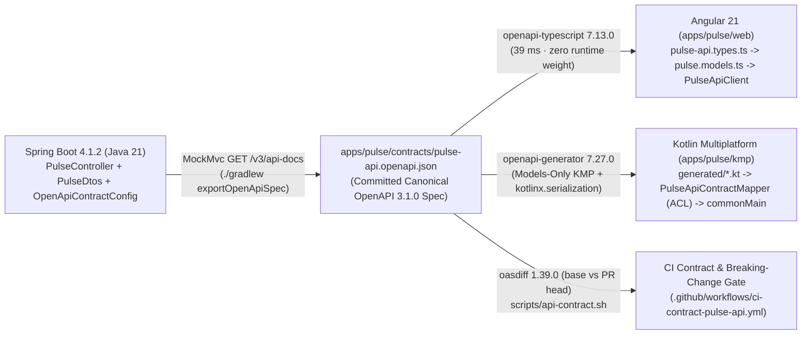
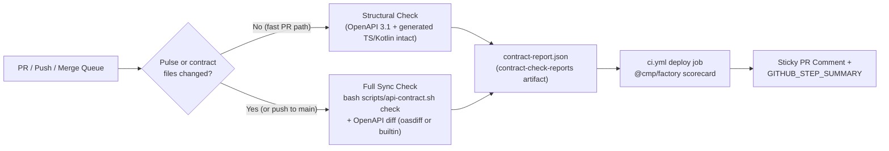

# Contract-First APIs & End-to-End Type Safety Playbook (RFC-0003 / ADR-0005)

> **Purpose:** A permanent, hands-on engineering and learning reference for keeping a **Spring Boot 4 (`Java 21`)** backend, an **Angular 21 (`TypeScript 5.9`)** web app, and a **Kotlin Multiplatform (`JVM` + `wasmJs`)** core locked onto a single **OpenAPI 3.1.0** contract — with stale-client detection and `oasdiff` breaking-change gates in CI.

- **Current Status:** **Implemented & Verified Across All 3 Stacks** (`springdoc-openapi 3.2.0` -> `apps/pulse/contracts/pulse-api.openapi.json` -> `openapi-typescript 7.13.0` + `openapi-generator 7.27.0` + `oasdiff 1.39.0`, promoted to [`ADR-0005`](../adr/0005-contract-first-openapi-across-spring-angular-kmp.md)).

---

## 1. Architecture Overview Across All Stacks

Instead of hand-maintaining matching DTOs in Java, TypeScript, and Kotlin — where a renamed field, changed enum value, or unexpected `null` causes silent runtime crashes — one machine-readable **OpenAPI 3.1.0** document drives both client ecosystems and CI compatibility gates:



### Cross-Stack Contract Matrix

| Layer | Directory / File | Tooling & Version | What It Produces / Verifies |
|---|---|---|---|
| **Producer** | [`apps/pulse/backend`](../../apps/pulse/backend) | `springdoc-openapi-starter-webmvc-ui 3.2.0` + Jackson 3 | Serves `/v3/api-docs` & `/swagger-ui.html`; exports canonical sorted OpenAPI 3.1 JSON; fails `./gradlew test` if committed spec drifts |
| **Canonical Contract** | [`apps/pulse/contracts/pulse-api.openapi.json`](../../apps/pulse/contracts/pulse-api.openapi.json) | OpenAPI `3.1.0` | Single source of truth for 6 `/api/v1/pulse/*` endpoints and 21 schemas (including 6 named enum schemas) |
| **Golden Wire Fixture** | [`apps/pulse/contracts/fixtures/pulse-state.golden.json`](../../apps/pulse/contracts/fixtures/pulse-state.golden.json) | Shared JSON fixture | Verified against live Spring Boot `MockMvc`, Angular `PulseDashboardResponse`, and KMP `PulseApiContractMapper` |
| **Web Consumer** | [`apps/pulse/web/src/app/api`](../../apps/pulse/web/src/app/api) | `openapi-typescript 7.13.0` | Zero-runtime `pulse-api.types.ts` + typed `PulseApiClient` wrapping Angular `HttpClient` (`255.03 kB` raw bundle) |
| **KMP Consumer** | [`apps/pulse/kmp/src/commonMain/kotlin/com/pulse/kmp/api`](../../apps/pulse/kmp/src/commonMain/kotlin/com/pulse/kmp/api) | `org.openapi.generator 7.27.0` (`multiplatform`) | 21 `@Serializable` Kotlin models compiling cleanly to both **JVM** and **`wasmJs`** + Anti-Corruption Layer (`PulseApiContractMapper`) |
| **Breaking-Change Gate** | [`scripts/api-contract.sh`](../../scripts/api-contract.sh) | `oasdiff 1.39.0` + `oasdiff/oasdiff-action@v0.2.1` | Fails PRs on removed required fields, removed enum values, or narrowed types; allows safe Expand-and-Contract additions |

---

## 2. Core Concepts Deep Dive (Tied to Real Code)

### 2.1 Code-First Export vs. Spec-First OpenAPI (Preserving `ADR-007`)

There are two ways to obtain an OpenAPI contract:
1. **Spec-First**: Hand-write `openapi.yaml` first and generate Spring server interfaces + client SDKs from it.
2. **Code-First Export + Committed Spec Gate (Chosen Here)**: Spring MVC controllers and Java 21 `record`s generate `/v3/api-docs`, which is exported via [`OpenApiContractExportTest.java`](../../apps/pulse/backend/src/test/java/com/pulse/backend/api/OpenApiContractExportTest.java) to a **committed** `pulse-api.openapi.json` that gates downstream codegen and `oasdiff`.

Why Code-First Export + Committed Spec fits `apps/pulse` best:
- **Zero-Annotation Pure Domain (`ADR-007`)**: [`com.pulse.backend.domain`](../../apps/pulse/backend/src/main/java/com/pulse/backend/domain) models (`TaskItem`, `TaskAccountabilityStatus`, `TaskHorizonAnalyticsSnapshot`, `WcagContrastEngine.ContrastAuditEntry`) must stay 100% free of Spring, Servlet, Lombok, Swagger, and Springdoc imports — enforced by [`ArchitectureTest.java`](../../apps/pulse/backend/src/test/java/com/pulse/backend/ArchitectureTest.java). Instead of polluting domain classes with `@Schema` annotations, [`OpenApiContractConfig.java`](../../apps/pulse/backend/src/main/java/com/pulse/backend/config/OpenApiContractConfig.java) uses an `OpenApiCustomizer` to hoist enums and normalize OpenAPI 3.1 nullability and required fields centrally.
- **No Unnoticed Backend Drift**: Because `OpenApiContractExportTest` compares live `/v3/api-docs` against the committed [`pulse-api.openapi.json`](../../apps/pulse/contracts/pulse-api.openapi.json) byte-for-byte on every `./gradlew test`, a backend developer cannot change a Java `record` or endpoint without regenerating the spec and exposing the change to `oasdiff` and client typecheckers.
- **Actuator Exclusion**: [`application.yml`](../../apps/pulse/backend/src/main/resources/application.yml) sets `springdoc.paths-to-match: /api/v1/pulse/**` so operational `/actuator/health/*` and `/actuator/info` probes (`ADR-0004`) do not leak into client SDKs.

### 2.2 OpenAPI 3.1 Nullability & Strict Requiredness

OpenAPI 3.0 used a non-standard `nullable: true` boolean. **OpenAPI 3.1.0** aligns directly with JSON Schema Draft 2020-12 using type arrays (`"type": ["string", "null"]`):

| Contract Shape | JSON Schema in `pulse-api.openapi.json` | Generated TypeScript (`strict: true`) | Generated Kotlin (`kotlinx.serialization`) | Pulse Example |
|---|---|---|---|---|
| **Required non-null** | `"type": "string"` + in `required: [...]` | `title: string` | `@Required val title: kotlin.String` | `TaskItem.title` |
| **Required nullable (response)** | `"type": ["string", "null"]` + in `required: [...]` | `googleTaskId: string \| null` | `@Required val googleTaskId: kotlin.String?` | `TaskItem.googleTaskId`, `dueEpochMillis`, `completedEpochMillis`, `pendingSwapCandidateTaskId`, `suggestedActionCode` |
| **Optional nullable (request)** | `"type": ["string", "null"]` + **omitted** from `required` | `waitingOn?: string \| null` | `val waitingOn: kotlin.String? = null` | `TriageRequest.waitingOn`, `TriageRequest.postponeDays` |

Notice how [`OpenApiContractConfig.java`](../../apps/pulse/backend/src/main/java/com/pulse/backend/config/OpenApiContractConfig.java) enforces this split explicitly via `NULLABLE_REQUIRED_RESPONSE_FIELDS` and `OPTIONAL_NULLABLE_REQUEST_FIELDS` so neither Angular nor Kotlin ever treats a nullable JSON property as non-null or a required response field as optional!

### 2.3 Angular 21 Zero-Runtime-Overhead Pattern (`openapi-typescript`)

Instead of generating heavy runtime service classes with duplicate serialization boilerplate, `apps/pulse/web` uses [`openapi-typescript`](../../apps/pulse/web/package.json):
1. `npm run api:generate` compiles [`pulse-api.openapi.json`](../../apps/pulse/contracts/pulse-api.openapi.json) into [`src/app/api/generated/pulse-api.types.ts`](../../apps/pulse/web/src/app/api/generated/pulse-api.types.ts) (`paths`, `components`, `operations`) in ~`40 ms` — adding **0 bytes** of runtime JavaScript.
2. [`pulse.models.ts`](../../apps/pulse/web/src/app/models/pulse.models.ts) re-exports `components['schemas'][...]` directly, eliminating hand-copied DTO interfaces completely, plus exports a runtime `isTriageActionCode` type guard.
3. [`PulseApiClient`](../../apps/pulse/web/src/app/api/pulse-api.client.ts) maps `operations['getPulseState']`, `operations['triageTask']`, etc. directly onto Angular's native `HttpClient`, preserving interceptors, `provideHttpClient()`, and RxJS cancellation while staying inside the `500 kB` bundle budget (`255.03 kB` raw / `70.07 kB` transfer).
4. [`PulseStateService`](../../apps/pulse/web/src/app/services/pulse-state.service.ts) and [`StalledTaskCardComponent`](../../apps/pulse/web/src/app/components/stalled-task-card/stalled-task-card.component.ts) enforce `TriageActionCode` end-to-end — even in Angular HTML templates (`strictTemplates: true`).

### 2.4 KMP Models-Only Codegen & Anti-Corruption Layer (ACL)

Generating full Ktor HTTP client stubs from `openapi-generator` often introduces verbose infrastructure classes and `wasmJs` compatibility snags. Instead, [`apps/pulse/kmp/build.gradle.kts`](../../apps/pulse/kmp/build.gradle.kts) runs `org.openapi.generator` (`7.27.0`, `library = "multiplatform"`) in **Models-Only** mode (`models = ""`, `apis = "false"`, `supportingFiles = "false"`):
- Emits 21 pure `@Serializable` Kotlin data classes and enums into [`src/commonMain/kotlin/com/pulse/kmp/api/generated/`](../../apps/pulse/kmp/src/commonMain/kotlin/com/pulse/kmp/api/generated/).
- Zero `java.*` or `android.*` imports (`ADR-008` `codeQuality` passes across `commonMain`, `jvm`, and `wasmJs`).
- [`PulseApiContractMapper.kt`](../../apps/pulse/kmp/src/commonMain/kotlin/com/pulse/kmp/api/PulseApiContractMapper.kt) acts as an **Anti-Corruption Layer (ACL)** between wire DTOs and the pure KMP domain ([`PulseKmpCore.kt`](../../apps/pulse/kmp/src/commonMain/kotlin/com/pulse/kmp/domain/PulseKmpCore.kt)):
  - **Solves real enum drift cleanly**: The backend classifies `LONG_STANDING_GHOSTED`, `ACTIVE_COMMITTED`, `HEALTHY_BACKLOG`, and `COMPLETED_OR_PARKED`, whereas KMP's pure domain uses `LONG_STANDING_IDLE`, `COMMITTED_TOP_3`, `ACTIVE_FLOW`, `SOMEDAY_PARKED`, and `COMPLETED`. `PulseApiContractMapper.toKmpCategory(...)` translates at the boundary so domain engines never depend on wire naming.
  - **Configures `PulseApiJson`** with `ignoreUnknownKeys = true` and `explicitNulls = false` so older mobile/Wasm builds survive additive backend fields without crashing.

### 2.5 Expand-and-Contract Evolution & Safe vs. Breaking Changes

| Change Type | Example | Safe? | `oasdiff` Result | Rollout Strategy |
|---|---|---|---|---|
| **Add optional response field** | Add `"focusScore": { "type": ["integer", "null"] }` (not `required`) | Yes | `0 error` (`info`) | **Expand**: ship backend first; clients with `ignoreUnknownKeys = true` ignore until updated |
| **Add optional request field** | Add nullable `notes` to `TriageRequest` (not `required`) | Yes | `0 error` | Ship backend accepting optional field; clients opt in later |
| **Remove required response field** | Delete `statusBanner` from `PulseDashboardResponse` | **No** | `ERR [response-required-property-removed]` | **Expand-and-Contract**: deprecate -> migrate all clients -> remove in a later release |
| **Remove request enum value** | Remove `"SHRINK_TO_5M"` from `TriageActionCode` | **No** | `ERR [request-property-enum-value-removed]` | Keep handling legacy enum value on server until zero clients emit it |
| **Make optional field required** | Move `waitingOn` into `TriageRequest.required` | **No** | `ERR [request-property-became-required]` | Add new versioned endpoint or default missing values server-side |

### 2.6 Protocol Decision Matrix: REST + OpenAPI 3.1 vs. Alternatives

| Criterion | REST + OpenAPI 3.1 (Pulse Standard) | gRPC / Protobuf | GraphQL |
|---|---|---|---|
| **Browser / Edge Proxy** | Native JSON over HTTP/1.1 & HTTP/2 (`Nginx` -> Cloud Run works out of the box) | Needs gRPC-Web / Envoy translation layer | Single `POST` endpoint; harder HTTP edge caching |
| **Angular & KMP `wasmJs`** | `openapi-typescript` (types-only) + `kotlinx.serialization` models compile natively to Wasm | Heavy runtime stubs in `wasmJs` | Extra normalized client cache complexity |
| **Debugging & CI Diff** | Human-readable JSON + `curl` + Swagger UI + `oasdiff` PR gate | Binary wire format; `buf breaking` | Schema stitching & N+1 query tuning |
| **When to Reconsider** | Internal high-throughput streaming RPC between backend microservices | Use **gRPC** for backend-to-backend streams | Use **GraphQL** only for deeply nested, client-driven query graphs |

---

## 3. Real-World Toolchain Gotchas Solved Live

1. **Spring Boot 4.1.2 uses Jackson 3 (`tools.jackson.*`)**:
   - Jackson 3 moved `ObjectMapper` and `JsonMapper` from `com.fasterxml.jackson.databind.*` to `tools.jackson.databind.*`, and `ObjectMapper.writer(PrettyPrinter)` became `ObjectMapper.writer().with(PrettyPrinter)` (used in [`OpenApiContractExportTest.java`](../../apps/pulse/backend/src/test/java/com/pulse/backend/api/OpenApiContractExportTest.java)).
2. **`springdoc-openapi 3.2.0` inlines Java enums & OpenAPI 3.1 `types`**:
   - By default, enum fields are inlined on each DTO property (`AccountabilityCategory` duplicated across schemas). Hoisting them via `OpenApiContractConfig.pulseContractSchemaCustomizer()` gives clean `#/components/schemas/<EnumName>` refs, and setting `enumSchema.setTypes(Set.of("string"))` (not just `setType("string")`) ensures OpenAPI 3.1 serialization preserves `"type": "string"` for `openapi-generator`.
3. **`openapi-generator 7.27.0` KMP `multiplatform` requires `DirectoryProperty` + `dateLibrary` + `@SerialName` awareness**:
   - In Gradle Kotlin DSL, `outputDir` is a `DirectoryProperty` (`outputDir.set(generatedOpenApiDir)`, not `.map { it.asFile.absolutePath }`).
   - `library = "multiplatform"` fails unless `dateLibrary = "kotlinx-datetime"` is set explicitly.
   - Enum values containing digits (`SHRINK_TO_5M`) map to Kotlin constant `SHRINK_TO_5_M` annotated with `@SerialName(value = "SHRINK_TO_5M")`, so Kotlin code uses `TriageActionCode.SHRINK_TO_5_M` while JSON wire payloads stay `"SHRINK_TO_5M"`.
4. **`apps/pulse/web` test typing without `@types/node`**:
   - `apps/pulse/web` deliberately omits `@types/node` (`tsconfig.app.json` has `"types": []`). Unit tests reading local contract fixtures under Vitest use a dynamic specifier (`import(/* @vite-ignore */ fsModule)`) rather than static `import fs from 'node:fs'` so `tsc --noEmit` stays green without modifying app compiler settings.
5. **`oasdiff/oasdiff-action@v0.2.1` inputs**:
   - `base:` and `revision:` expect filesystem paths (not `git-ref:path`), and `review` defaults to `'true'` (which uploads encrypted specs to `oasdiff.com`). Setting `review: "false"` and extracting the base branch spec to `$RUNNER_TEMP` in [`.github/workflows/ci-contract-pulse-api.yml`](../../.github/workflows/ci-contract-pulse-api.yml) keeps CI self-contained and offline-safe.

---

## 4. Hands-On Learning Labs (Try It Yourself)

Run all labs from the monorepo root (`/Users/stefan/Code/monorepo`).

### Lab 1 — Explore Live Swagger UI & `/v3/api-docs`

```bash
cd apps/pulse/backend && ./gradlew bootRun
```

In a second terminal:
- Fetch the live OpenAPI 3.1 document: `curl -s http://127.0.0.1:8080/v3/api-docs | head -n 30`
- Open interactive Swagger UI in your browser: <http://127.0.0.1:8080/swagger-ui.html>
- Confirm `/actuator/*` endpoints do **not** appear in `/v3/api-docs` (`paths-to-match: /api/v1/pulse/**`), while `/actuator/health/readiness` still responds cleanly on `:8080`.

### Lab 2 — Run the Cross-Stack Contract Sync & Compare Generated Clients

```bash
bash scripts/api-contract.sh sync
bash scripts/api-contract.sh check
```

Compare how the exact same OpenAPI 3.1 schema (`TaskItem`) projects into both client stacks:
- TypeScript: [`apps/pulse/web/src/app/api/generated/pulse-api.types.ts`](../../apps/pulse/web/src/app/api/generated/pulse-api.types.ts) (`googleTaskId: string | null`)
- Kotlin Multiplatform: [`apps/pulse/kmp/src/commonMain/kotlin/com/pulse/kmp/api/generated/TaskItem.kt`](../../apps/pulse/kmp/src/commonMain/kotlin/com/pulse/kmp/api/generated/TaskItem.kt) (`val googleTaskId: kotlin.String?`)

### Lab 3 — Run the `oasdiff` Expand vs. Breaking-Change Drill (Non-Destructive)

```bash
bash scripts/api-contract.sh drill
```

**What to observe:**
- **Drill A (Expand)**: Adding optional nullable `focusScore` produces `6 changes: 0 error, 0 warning, 6 info` (`[response-optional-property-added]`) and exits `0`.
- **Drill B (Breaking)**: Removing required `statusBanner` + enum value `SHRINK_TO_5M` produces `7 changes: 7 error` and exits non-zero, caught automatically before merge.

### Lab 4 — Watch Compile-Time Drift Catch a Backend Rename

1. Temporarily rename a field in [`PulseDtos.java`](../../apps/pulse/backend/src/main/java/com/pulse/backend/api/PulseDtos.java) (e.g., `statusBanner` -> `bannerText`), or inspect what breaks if you only change Java:
   - `(cd apps/pulse/backend && ./gradlew test)` immediately fails `OpenApiContractExportTest` because the committed `pulse-api.openapi.json` is stale.
2. Run `bash scripts/api-contract.sh sync` and then run Angular & KMP typechecks:
   - `(cd apps/pulse/web && npm run typecheck)` fails immediately wherever `statusBanner` is read.
   - `(cd apps/pulse/kmp && ./gradlew compileKotlinJvm compileKotlinWasmJs)` fails immediately at compile time.
3. Revert your temporary edit (`git checkout -- apps/pulse/`) and run `bash scripts/api-contract.sh check`.

### Lab 5 — Verify KMP Expand-and-Contract Forward Compatibility

Read and run [`PulseApiContractTest.kt`](../../apps/pulse/kmp/src/commonTest/kotlin/com/pulse/kmp/api/PulseApiContractTest.kt):

```bash
scripts/check.sh --stack kmp
```

Notice `expandAndContractResilienceIgnoresUnknownAdditiveBackendFields()` injects `"focusScore": 92` and `"futureBannerBadge": "v2"` into the server payload and proves `PulseApiContractMapper.decodeDashboardResponse()` parses it without error thanks to `ignoreUnknownKeys = true`.

---

## 5. CI Contract Gate, Diff Tools (`oasdiff` vs. `builtin`), and PR Scorecard Visibility

Every pull request, `push` to `main`, and `merge_group` run in [`.github/workflows/ci.yml`](../../.github/workflows/ci.yml) executes [`.github/workflows/ci-contract-pulse-api.yml`](../../.github/workflows/ci-contract-pulse-api.yml) (`contracts` job) alongside `gradle` and `node` before feeding into **`Release Readiness Scorecard`**:



### Selecting & Swapping OpenAPI Diff Engines

Both CI and `scripts/api-contract.sh` emit a tool-agnostic `contract-report.json` consumed by [`packages/factory/src/scorecard.ts`](../../packages/factory/src/scorecard.ts), decoupling PR scorecard visibility from any single diff binary:

| Engine | How It Runs | Strengths & Trade-offs |
|---|---|---|
| **`oasdiff` (Default)** | `oasdiff/oasdiff-action@v0.2.1` in CI; `oasdiff` CLI or Docker locally (`CONTRACT_DIFF_TOOL=auto`) | Deep semantic OpenAPI 3.1 rule engine (300+ checks, GitHub PR line annotations, `ERR`/`WARN`/`INFO` classification) |
| **`builtin` Fallback (`scripts/openapi-diff-fallback.mjs`)** | Pure Node ESM (`node scripts/openapi-diff-fallback.mjs`, or `diff-tool: builtin` / `CONTRACT_DIFF_TOOL=builtin`) | Zero external downloads or Docker dependency; checks removed paths/methods, removed 2xx statuses, removed schemas/properties/enums, newly required fields, and incompatible property types |
| *Alternatives Evaluated* | **Optic** (SaaS-oriented cloud workflow / Node CLI) & **OpenAPITools `openapi-diff`** (heavy JVM runtime setup per CI runner) | Skipped in favor of lightweight `oasdiff` + zero-dependency Node fallback |

### What Appears in the PR Comment & Step Summary

In `.github/workflows/ci.yml`, `Release Readiness Scorecard` runs `formatPrScorecardComment` and `formatStepSummaryMarkdown` **even when upstream jobs fail** before failing the required check cleanly at the final step (`if: always()`):
- **Overall PR Table (`<!-- cmp-release-readiness-scorecard -->`):** Displays `Overall Score` (`11` capabilities including `API Contracts (OpenAPI)`), `CI Gate` (`🟢 PASS` / `🔴 FAIL`), `API Contract Gate` badge, and per-job status (`discover`, `gradle`, `node`, `contracts`).
- **Fast Unchanged PR:** Shows `🟢 PASS (fast path · spec unchanged · 6 endpoints, 21 schemas)` without booting Gradle or Android/Kotlin toolchains inside `contracts`.
- **Additive Expand Change:** Passes gate and includes a collapsible `<details><summary>OpenAPI Changelog</summary>` listing non-breaking additions (`INFO`).
- **Sync Drift Failure:** Shows `🔴 FAIL (OpenAPI / Angular / KMP drift detected)`, exact drift output (`<details open>`), and remediation (`bash scripts/api-contract.sh sync` / `pnpm api:sync`).
- **Breaking Change Failure:** Shows `🔴 FAIL (breaking API changes ...)`, exact `ERR` violations (`<details open>`), and Expand-and-Contract remediation guidance.
