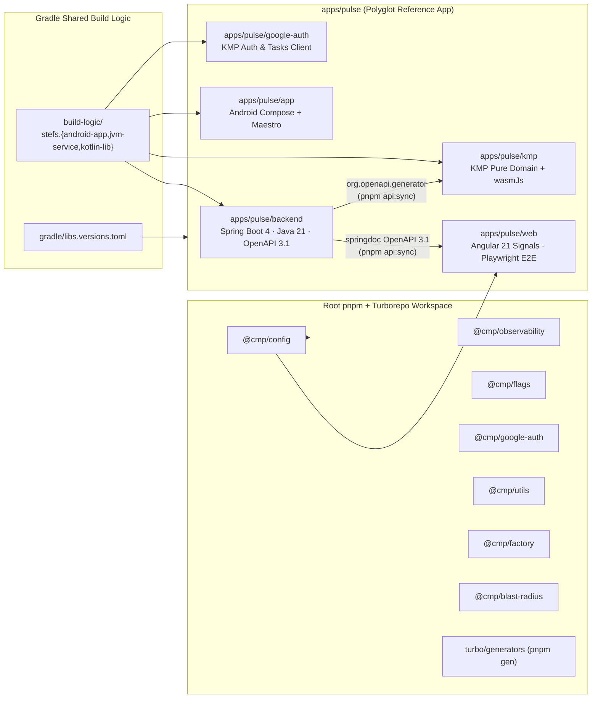

# Developer Onboarding Runbook (Day 1 → First PR)

This guide walks a new human engineer from a fresh clone to running every stack locally, generating new modules, verifying changes with CI parity, and landing a clean pull request.

---

## 1. Architecture Mental Model



Key boundaries to know up front:
- **Root pnpm workspace (`pnpm-workspace.yaml`):** manages `apps/web`, `packages/*`, and `tools/*`.
- **Polyglot `apps/pulse`:** managed via Gradle (`apps/pulse`, `apps/pulse/backend`, `apps/pulse/kmp`, `apps/pulse/google-auth`) and standalone npm (`apps/pulse/web`), so it is excluded from `pnpm-workspace.yaml`.
- **Shared build config:** TypeScript packages extend `@cmp/config`; Gradle builds apply `stefs.*` plugins from `build-logic/` and versions from root `gradle/libs.versions.toml`.

---

## 2. Day-1 Machine Setup

### Required & Optional Tools

| Tool | Required for | Pinned Version (`mise.toml`) |
| :--- | :--- | :--- |
| **Node.js + pnpm** | Workspace packages, `apps/web`, `apps/pulse/web`, `pnpm gen`, docs/factory scripts | Node `20` · pnpm `9.12.3` |
| **JDK 21** | `apps/pulse/backend` (Java 21) & Gradle builds (`KMP` targets JDK 17) | `temurin-21` |
| **Python 3** | Affected-only CI discovery (`.github/scripts/discover_projects.py`) | Python `3.10+` |
| **Android SDK** | `apps/pulse/app` Android lint, APK assembly, Compose/unit tests | `ANDROID_HOME` (compileSdk `35`; skipped cleanly in local `check.sh` if unset) |
| **Docker** | Local production-parity Compose (`infra/compose.prod-local.yml`) | Docker Desktop / Engine |
| **GitHub CLI (`gh`)** | Checking PR status, CI logs, and workflow runs | Authenticated (`gh auth login`) |
| **Google Cloud CLI (`gcloud`)** | Manual Cloud Run deploy/rollback drills against `gw-cli-490302` | Optional for normal feature PRs |

### One-Command Bootstrap

```bash
./scripts/bootstrap.sh
```

What `./scripts/bootstrap.sh` does:
1. Installs pinned toolchains from [`mise.toml`](../mise.toml) if `mise` is installed.
2. Verifies parity between `mise.toml`, `.nvmrc`, `package.json`, Gradle, and CI workflows (`node scripts/check-toolchain-parity.mjs`).
3. Runs project discovery (`python3 .github/scripts/discover_projects.py`).
4. Installs root dependencies (`pnpm install --frozen-lockfile`), which registers **Lefthook** git hooks (`commit-msg` and `pre-push`).
5. Runs `./scripts/check.sh --changed`.

Use `./scripts/bootstrap.sh --check-only` for a read-only audit without installing anything.

### Credentials & Secrets Policy

- **Zero real Google credentials needed locally:** Unit tests, Angular dev/Playwright E2E, and KMP/Android auth tests use deterministic fakes (`FakeGoogleTasksStub`, `FakeGoogleOAuthProvider`, `pulse-seed.ts`).
- **CI deploys are keyless:** GitHub Actions authenticates to GCP (`gw-cli-490302`) via short-lived OIDC Workload Identity Federation tokens, never static JSON keys.

---

## 3. First-Hour Local Run Walkthrough

### A. Root TypeScript Packages & Tooling

```bash
pnpm lint && pnpm typecheck && pnpm build && pnpm test
pnpm arch:check      # dependency-cruiser boundary check
pnpm scorecard       # repo health & release-readiness summary
```

### B. `apps/pulse` Backend + Web (Two Terminals)

```bash
# Terminal 1: Spring Boot 4 API (:8080)
cd apps/pulse/backend && ./gradlew bootRun

# Terminal 2: Angular 21 SPA (:4200, proxies /api/* to :8080)
cd apps/pulse/web && npm ci && npm start
```

Or run both in production-parity containers:

```bash
docker compose -f infra/compose.prod-local.yml up --build
```

### C. Verification Suites

```bash
# Pulse Web unit tests (Vitest) + Playwright E2E
cd apps/pulse/web && npm test && npm run test:e2e

# Pulse Backend + KMP + Android
./scripts/check.sh --stack springboot
./scripts/check.sh --stack kmp
./scripts/check.sh --stack android

# OpenAPI 3.1 contract drift & breaking-change check
pnpm api:check
```

---

## 4. First-PR End-to-End Walkthrough

1. **Create a branch from `origin/main`:**
   ```bash
   git fetch origin && git checkout -b feat/ste-123-short-slug origin/main
   ```
2. **Scaffold instead of copy-pasting (if creating a new package/app):**
   - `pnpm gen lib <name>` → TypeScript library in `packages/`
   - `pnpm gen app web <name>` → Angular 21 Signals app in `apps/`
   - `pnpm gen app service <name> [--infra]` → Spring Boot 4 service in `apps/`
   - `pnpm gen app android <name>` → Kotlin/Compose Android app in `apps/`
3. **Sync API contracts if `apps/pulse/backend` endpoints or DTOs changed:**
   ```bash
   pnpm api:sync
   ```
4. **Run local CI-parity checks & docs verification:**
   ```bash
   ./scripts/check.sh --changed
   pnpm docs:check
   ```
5. **Commit using Conventional Commits (checked by Lefthook `commit-msg` & CI `commitlint`):**
   ```bash
   git commit -m "feat(pulse-web): add keyboard shortcut for rescue triage (STE-123)"
   ```
6. **Push & open a PR:**
   - Lefthook runs Gate 1 (`quality`) on `pre-push` for changed stacks.
   - GitHub Actions runs Affected-Only CI, Blast-Radius AST analysis, Security scans (`CodeQL`, `Gitleaks`, `Semgrep`, `Trivy`, `OSV-Scanner`), Playwright E2E, and (when `apps/pulse/web` changes) posts a live Cloud Run PR preview URL comment.
   - Squash-merge when green; `release-please` manages component changelogs and release tags (`pulse-backend-v*`, `pulse-web-v*`, `pulse-android-v*`).

---

## 5. Troubleshooting FAQ

- **macOS `zsh` fails with `no matches found` on globs/URLs:** Quote glob patterns (`'**/*.ts'`) and URLs in `zsh`.
- **`pnpm` missing in non-interactive shells:** Ensure Homebrew (`/opt/homebrew/bin`) or `mise` shims are on `PATH`, or invoke `npx --yes pnpm@9.12.3`.
- **Android stack prints `SKIP` in `scripts/check.sh`:** Set `ANDROID_HOME` (for example `~/Library/Android/sdk` on macOS). Use `CHECK_STRICT=1` to fail instead of skipping when an SDK is absent.
- **`API Contracts · Pulse OpenAPI 3.1` fails on PR:** Run `pnpm api:sync` locally and commit the updated `apps/pulse/contracts/pulse-api.openapi.json` and generated TS/KMP client files.
- **`Gitleaks` flags a fake token in a unit test:** Never put literal `ya29.` prefixes or 16+ char alphanumeric-with-digit strings assigned to `key`/`token` in test fixtures; use short descriptive placeholders like `fakeOauth` or `pulse-coach`.
- **`docs-check` fails on PR:** Run `pnpm docs:sync` if workflow inputs or project discovery tables changed, and verify all links inside `docs/` resolve to real files.

---

## Further Reading

- [`CONTRIBUTING.md`](../CONTRIBUTING.md)
- [`local-validation.md`](./local-validation.md)
- [`monorepo-conventions.md`](./monorepo-conventions.md)
- [`ci-reusable-workflows.md`](./ci-reusable-workflows.md)
- [`guides/01-single-command-prod-deploy-and-rollback-playbook.md`](./guides/01-single-command-prod-deploy-and-rollback-playbook.md)
- [`guides/02-contract-first-apis-openapi-playbook.md`](./guides/02-contract-first-apis-openapi-playbook.md)
- [`guides/03-agent-delivery-guardrails-playbook.md`](./guides/03-agent-delivery-guardrails-playbook.md)
