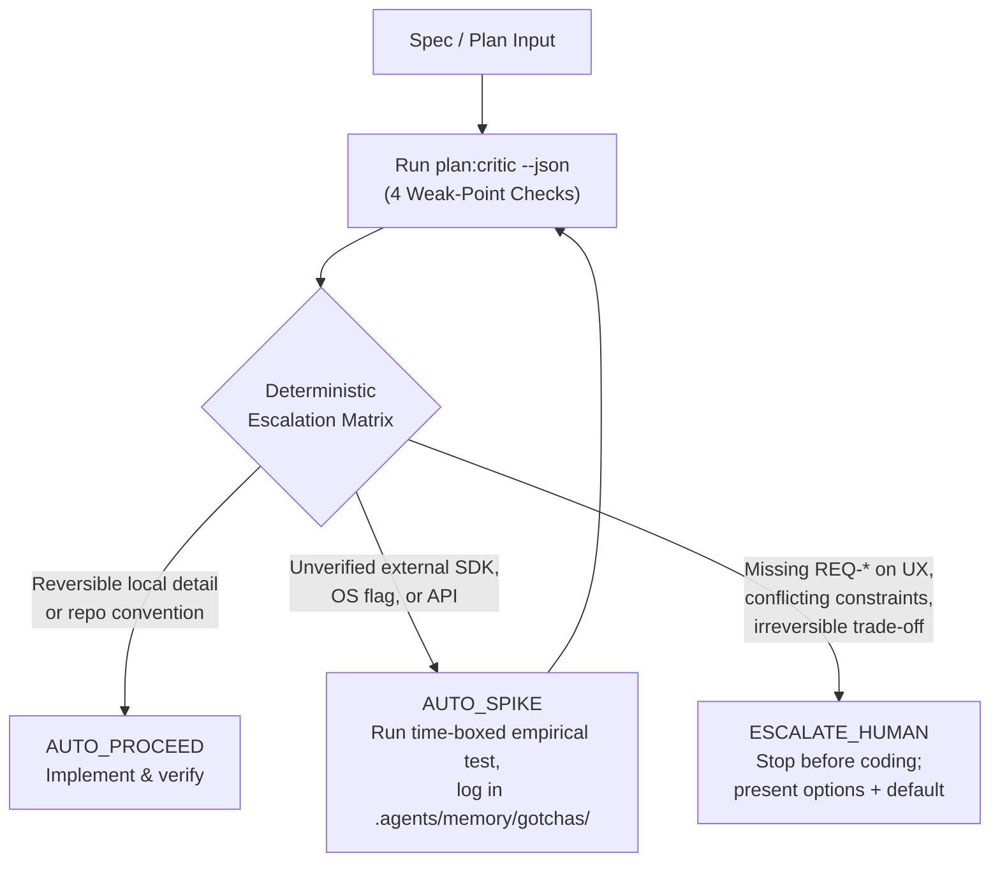

# 06. SOTA Quality Engineering & Pre-Execution Planning Critic

> **Track 6 Guide**: From 5-minute local quality gates to industry-bedrock DevSecOps, real-DOM accessibility, mutation/architecture fitness, DORA deployable health, and the **Pre-Execution Planning Critic** (`plan:critic`) with its **Deterministic Escalation Matrix** and **Tier 2 Enterprise Transfer Playbook**.

---

## Level 1: The Basics (5-Minute Mental Model & Quickstart)

### Why Quality Engineering Is More Than "Tests Pass"

A green unit-test run only proves that the assertions you remembered to write passed against inputs you anticipated. In modern polyglot and AI-assisted monorepos, **"tests pass" still ships five classes of failure**:

1. **Weak assertions**: 90% line coverage can still miss inverted conditionals or dropped boundary checks (caught by **mutation testing**).
2. **Architectural drift**: A green build can still introduce forbidden layer imports (caught by **architecture fitness functions**).
3. **Inaccessible UI**: Unit tests on pure functions or components do not catch obscured focus rings or undersized touch targets in a rendered browser DOM (caught by **real-DOM WCAG 2.2 AA audits**).
4. **Supply-chain & secret exposure**: Passing tests do not notice an unpinned CI action, a vulnerable transitive dependency, or a leaked token in git history (caught by **layered DevSecOps**).
5. **Flawed specs executed fast**: Autonomous agents can write clean, passing code for an *underspecified or contradictory plan*—wasting an entire cycle before anyone notices the wrong problem was solved (caught by the **Pre-Execution Planning Critic**).

Quality Engineering (QE) treats **planning, architecture, accessibility, security, and deployability** as one continuous, automated feedback loop.

### The 3 Commands to Run Locally

Before writing code or opening a PR in this monorepo, you only need three commands:

```bash
# 1. Pre-flight: audit a spec or plan for weak points BEFORE coding
node packages/factory/dist/src/cli.js plan:critic path/to/plan.md --json

# 2. Fast factory guardrails: AGENTS.md, WCAG/Zero-PII self-tests, typecheck & unit tests
pnpm verify:slice --json

# 3. Full CI-parity gates for every stack you touched (plus optional security gate)
scripts/check.sh --changed
scripts/check.sh --gate security
```

> **Tip**: If `packages/factory/dist/` has not been built yet, run `pnpm --filter @cmp/factory build` first.

---

## Level 2: Industry Bedrock & Best Practices

The four foundational pillars of modern Quality Engineering give us objective, repeatable signals across code, UI, supply chain, and production delivery.

### Pillar 1: Code Quality & Architecture Fitness

- **Mutation Testing ([StrykerJS](https://stryker-mutator.io/) for JS/TS, [Pitest](https://pitest.org/) for Java/JVM)**:
  Line coverage measures which lines *executed*, not whether tests would fail if the code broke. Mutation testing automatically injects small faults ("mutants" such as flipping `>` to `>=`, negating conditions, or returning empty arrays) and measures the **mutation score**—the percentage of mutants killed by your test suite. Run mutation testing on PRs or nightly schedules for critical domain logic rather than every local save.
- **AST & Bytecode Architecture Fitness Functions ([`dependency-cruiser`](https://github.com/sverweij/dependency-cruiser) for JS/TS, [ArchUnit](https://www.archunit.org/) for JVM)**:
  Regex and `grep`-based boundary checks break on aliased imports, barrel re-exports, or multi-line statements. `dependency-cruiser` parses the real JS/TS module graph (banning circular dependencies and cross-layer imports via [declarative rules](https://github.com/sverweij/dependency-cruiser/blob/main/doc/rules-reference.md)), while `ArchUnit` asserts package/layer/cycle invariants directly inside JUnit tests against compiled JVM bytecode.

### Pillar 2: Accessibility Standards (Real-DOM WCAG 2.2 AA)

- **Automated DOM & Interactive-State Audits ([Playwright Accessibility Testing](https://playwright.dev/docs/accessibility-testing) + [`@axe-core/playwright`](https://github.com/dequelabs/axe-core-npm/tree/develop/packages/playwright))**:
  Color-contrast math on static palette tokens is necessary ([Guide 02](./02-shared-guardrail-primitives.md)), but it cannot verify computed CSS, keyboard navigation, ARIA roles, or **WCAG 2.2** criteria such as *Focus Not Obscured* (SC 2.4.11) and *Target Size (Minimum)* (SC 2.5.8) ([W3C WCAG 2.2](https://www.w3.org/TR/WCAG22/)).
- **Best Practice**: Run `AxeBuilder` inside `@playwright/test` against **rendered pages and open interactive states** (modals, menus, form error states):

```typescript
import { test, expect } from '@playwright/test';
import AxeBuilder from '@axe-core/playwright';

test('interactive modal meets WCAG 2.2 AA', async ({ page }) => {
  await page.goto('/');
  await page.getByRole('button', { name: 'Settings' }).click();

  const results = await new AxeBuilder({ page })
    .withTags(['wcag2a', 'wcag2aa', 'wcag21a', 'wcag21aa', 'wcag22aa'])
    .analyze();

  expect(results.violations).toEqual([]);
});
```

- **Important Caveat**: Automated tools like [`axe-core`](https://github.com/dequelabs/axe-core) catch ~30–50% of accessibility barriers; pair them with baseline suppression for legacy debt (failing PRs only on *new* violations) and manual keyboard/screen-reader checks.

### Pillar 3: Vulnerability & Supply Chain Management

Defense-in-depth DevSecOps scans five distinct surfaces in CI/CD:

| Surface | Industry Standard Tool | What It Catches |
| :--- | :--- | :--- |
| **Secret History** | [Gitleaks](https://github.com/gitleaks/gitleaks) (`fetch-depth: 0`) | API keys, private keys, and tokens committed anywhere in git history or PR diffs. |
| **Dependency SCA** | [OSV-Scanner](https://github.com/google/osv-scanner) | Known CVEs across lockfiles (`pnpm-lock.yaml`, Gradle, SwiftPM) using the Open Source Vulnerabilities database. |
| **SAST (Code Patterns)** | [Semgrep](https://semgrep.dev/) / [CodeQL](https://codeql.github.com/) | Injection flaws, unsafe deserialization, auth bypasses, and custom security anti-patterns. |
| **FS / Container / IaC** | [Trivy](https://github.com/aquasecurity/trivy) (SARIF) | Misconfigurations, OS/container vulnerabilities, and lockfile risks uploaded to the GitHub Security tab. |
| **SBOM & CI Hardening** | [CycloneDX](https://cyclonedx.org/) + [GitHub Actions Hardening](https://docs.github.com/en/actions/security-for-github-actions/security-guides/security-hardening-for-github-actions) | Standardized Software Bill of Materials (`cyclonedx` JSON) plus pinning third-party Actions to immutable full-length commit SHAs with least-privilege `GITHUB_TOKEN` permissions. |

### Pillar 4: Deployable Health Tracking

Shipping fast without breaking production requires connecting pre-merge checks to runtime health:

- **DORA Metrics ([dora.dev](https://dora.dev/))**:
  Track the balanced DORA framework ([DORA Four Keys & Five Metrics](https://dora.dev/guides/dora-metrics-four-keys/)) against your own historical trend rather than vanity targets:
  - *Throughput*: **Deployment Frequency**, **Lead Time for Changes**, **Failed Deployment Recovery Time** (formerly MTTR).
  - *Stability*: **Change Failure Rate (CFR)**, **Deployment Rework Rate**.
- **Release Readiness Scorecards**:
  Replace manual Change Advisory Boards (CABs) with an automated CI verdict (`scorecard.json`) that aggregates build/test gates, SAST/SCA/SBOM artifacts, and DORA context before promoting a release.
- **Synthetic Canary Checks**:
  Roll out to a small traffic slice first and run automated synthetic probes (HTTP status, p95 latency, critical-path assertions) that trigger immediate rollback on regression.

---

## Level 3: Deep Dive — The Agentic Edge & Planning Weak-Point Loop

### How This Monorepo Automates QE

This repository wires local hooks, CI parity, security scanning, release scorecards, and pre-execution planning into one cohesive loop:

| Layer | File / Command | What It Enforces |
| :--- | :--- | :--- |
| **Git Hooks** | [`lefthook.yml`](../../lefthook.yml) | `pre-commit` blocks `@ts-ignore`, secret-like filenames, invalid shell syntax, and optional `gitleaks-staged` / `actionlint`; `pre-push` runs Gate 1 for changed stacks. |
| **Local CI Parity** | [`scripts/check.sh`](../../scripts/check.sh) ([guide](../local-validation.md)) | macOS `/bin/bash` 3.2-compatible runner across all stacks (`pnpm-turborepo`, `angular`, `springboot`, `android`, `kmp`, `ytm-menubar`), Gates 1–3 + `--gate security` (`gitleaks`, `osv-scanner`). |
| **Factory Closed Loop** | `pnpm verify:slice --json` ([Guide 04](./04-closed-loop-verification-harness.md)) | `AGENTS.md` / zero-`catalog-info.yaml` audit, WCAG/Zero-PII self-tests, and workspace typecheck + tests. |
| **Layered CI Security** | [`.github/workflows/security.yml`](../../.github/workflows/security.yml) | PR + weekly schedule running Gitleaks, OSV-Scanner, Semgrep, Trivy (SARIF), and CycloneDX SBOM upload. |
| **Release Readiness** | [`.github/workflows/ci.yml`](../../.github/workflows/ci.yml) (`release-readiness`) | Aggregates stack gates into `scorecard.json` and posts a DORA-aligned readiness summary to `$GITHUB_STEP_SUMMARY`. |
| **Pre-Execution Critic** | `packages/factory` `plan:critic` + [`.agents/memory/process/planning-critic.md`](../../.agents/memory/process/planning-critic.md) | Audits specs/plans *before* agents write code; documented in [`ADR-MEM-004`](../../.agents/memory/decisions/ADR-MEM-004-sota-qe-and-planning-critic.md). |

### The Pre-Execution Planning & Input Weak-Point Loop

Before spawning implementation workers or editing files, agents run:

```bash
node packages/factory/dist/src/cli.js plan:critic <spec-or-plan.md> --json
```

`plan:critic` audits four weak-point categories:
1. **Underspecified Inputs**: Missing target entrypoints, missing `REQ-*` acceptance criteria, unbounded adjectives (`"fast"`, `"secure"` without thresholds), or undefined error/empty states.
2. **Missing Edge Cases**: Unspecified process/mode state transitions (auth/session persistence, dirty-state recovery, offline/timeout, retry/concurrency).
3. **Unverified External Assumptions**: Third-party SDK flags, OS/toolchain quirks, or API shapes not yet verified against [`.agents/memory/gotchas/`](../../.agents/memory/gotchas/INDEX.md) or lockfiles.
4. **Conflicting Constraints**: Proposed paths, imports, or dependencies that violate root [`AGENTS.md`](../../AGENTS.md), per-app `AGENTS.md`, `ci-projects.json`, or ADR boundaries.

### The Deterministic Escalation Matrix

To let agents drive large codebases autonomously without either **stalling on trivial questions** or **guessing on irreversible decisions**, every finding maps to one of three deterministic actions:



| Decision | Trigger Condition | Required Agent Action |
| :--- | :--- | :--- |
| **`AUTO_PROCEED`** | Detail is resolvable from `AGENTS.md` / repo conventions, or change is a reversible local refactor. | Proceed directly to implementation and verification. Do **not** interrupt the user. |
| **`AUTO_SPIKE`** | Unverified external assumption (SDK flag, API shape, OS/browser behavior, auth flow). | Run a minimal empirical spike first, record verified facts in `.agents/memory/gotchas/`, and re-run the critic. |
| **`ESCALATE_HUMAN`** | True decision boundary: conflicting product/business constraints, missing `REQ-*` criteria on user-facing behavior, frozen legacy boundary touch, or irreversible architectural/security trade-off. | **Stop before coding.** Present the exact ambiguity, concrete options, and recommended default to the user. |

---

### Tier 2 Enterprise Transfer Playbook

When transferring these practices from a lean monorepo to a large, multi-team enterprise codebase, **do not turn on every blocking gate on day one**. Roll out in three phases (recorded in [`ADR-MEM-004`](../../.agents/memory/decisions/ADR-MEM-004-sota-qe-and-planning-critic.md)):

1. **Phase 0 — Observe-Only (Weeks 1–2)**:
   - Run `plan:critic`, Gitleaks, OSV-Scanner, Semgrep, and Trivy in **non-blocking / SARIF-upload** mode.
   - Measure baseline findings, false-positive rate, and DORA metrics without halting developer velocity.
2. **Phase 1 — Baseline Ratcheting (Weeks 3–6)**:
   - Block PRs **only on regressions**: *new* leaked secrets, *new* critical/high CVEs in modified dependencies, and `ESCALATE_HUMAN` plan-critic triggers.
   - Add progressive `AGENTS.md` files in active directories and wrap existing enterprise build tools (`make`, `mvn`, `nx`, `bazel`) behind a unified `scripts/check.sh` entrypoint.
3. **Phase 2 — Strangler-Fig Critical Paths (Ongoing)**:
   - Enforce strict SOTA thresholds—StrykerJS/Pitest mutation scores (`>= 75%`), `dependency-cruiser`/`ArchUnit` boundary rules, `@playwright/test` + `@axe-core/playwright` WCAG 2.2 AA DOM checks, and `REQ-*` traceability—on **new vertical slices and Tier-1 revenue/auth domains**.
   - Leave untouched legacy monoliths undisturbed until refactored under the Strangler-Fig pattern.

---

**Previous Guide**: [05. SOTA Agentic Memory & Iteration Harness](./05-sota-agentic-memory-and-iteration-harness.md) · **Curriculum Index**: [Agentic Software Factory](./README.md)
