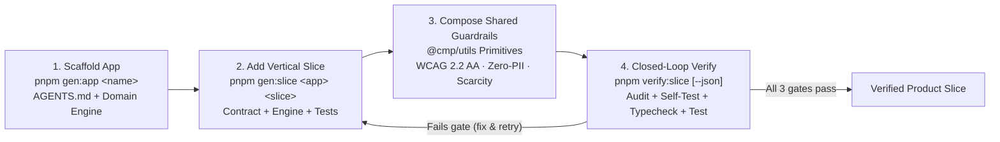

# Agentic Software Factory — Engineering Learning Library

> **From Static Developer Portals to Closed-Loop Agentic Engineering**: This curriculum explains how the `@cmp` monorepo operates as a self-verifying **Agentic Software Factory**, replacing manual Backstage catalog upkeep with executable guardrails, deterministic generators, and docs-as-agent-context.

---

## Why We Replaced Legacy Developer Portals

Traditional Internal Developer Portals (such as Backstage with static `catalog-info.yaml` descriptors and manual quality scorecards) were designed for human-curated service directories in large organizations. In an AI-native **Company of One** monorepo, static portals introduce unnecessary drag:

| Dimension | Legacy Developer Portal (Backstage + YAML) | Agentic Software Factory (`@cmp/factory` + `@cmp/utils`) |
| :--- | :--- | :--- |
| **Source of Truth** | Duplicated `catalog-info.yaml` metadata that drifts out of sync with code | Live workspace manifests (`package.json`, `pnpm-workspace.yaml`, `turbo.json`) + per-app `AGENTS.md` constitutions |
| **Dependency Overhead** | Separate Yarn 4 monorepo (`apps/backstage`), `@backstage/cli`, `@techdocs/cli` | Lean pnpm 9 + Turborepo workspace (`@cmp/config`, `@cmp/utils`, `@cmp/factory`, `@cmp/web`) |
| **Quality Governance** | Manual scorecards (`exp-quality-scorecard`) reviewed out-of-band | Automated 3-gate `pnpm verify:slice` loop running on every change |
| **Scaffolding** | Static templates requiring manual wiring of tests, linting, and guardrails | Deterministic `pnpm gen:app` & `pnpm gen:slice` wiring `@cmp/utils` primitives on day zero |
| **Guardrails** | Prose guidelines that agents or humans can accidentally bypass | Executable pure functional primitives (`auditThemePalette`, `scrubSensitiveText`, `evaluateScarcityGate`) |

The Agentic Software Factory rests on four pillars:
1. **Docs-as-Agent-Context (`AGENTS.md` + `docs/`)**: Every app declares an enforceable engineering constitution (`AGENTS.md`) alongside deep reference libraries (`docs/stack-best-practices/`, `docs/knowledge-base/`).
2. **Deterministic Generators (`@cmp/factory`)**: `pnpm gen:app` and `pnpm gen:slice` eliminate cold-start drift and placeholder scripts by scaffolding real TypeScript configs, vertical slices, and `node:test` suites.
3. **Shared Guardrail Primitives (`@cmp/utils`)**: Stateless pure functions (`ADR-007`) handle WCAG 2.2 Level AA contrast math, Zero-PII telemetry scrubbing, and Top-3 scarcity ranking across products.
4. **Closed-Loop Verification (`pnpm verify:slice`)**: A fast, deterministic CLI gate that emits human-readable output or `--json` diagnostics so both engineers and autonomous agents can self-correct in seconds.

---

## The 4-Stage Factory Loop

---

## Learning Curriculum (`01`–`05`)

| Guide | Track & Package | What You Will Learn |
| :--- | :--- | :--- |
| **[01. From Portals to Agentic Workspaces](01-from-portals-to-agentic-workspaces.md)** | Track 1 · Root Workspace (`pnpm-workspace.yaml`, `package.json`, `turbo.json`) | Why Backstage & static catalogs were sunset, how `AGENTS.md` + pnpm/Turborepo act as live contracts, and how polyglot `apps/pulse` coexists cleanly. |
| **[02. Shared Guardrail Primitives](02-shared-guardrail-primitives.md)** | Track 2 · `@cmp/utils` & `@cmp/web` | Pure Functional Core (`ADR-007`), WCAG 2.2 AA contrast math (`SC 1.4.3`), Zero-PII scrubbing & SHA-256 pseudonymization, and scarcity gates. |
| **[03. Deterministic App & Slice Generators](03-deterministic-app-and-slice-generators.md)** | Track 3 · `@cmp/factory` (`gen:app`, `gen:slice`) | Vertical Slice Architecture (`contract`, `engine`, `test`), multi-stack blueprints (`web-ts`, `angular-spring`, `kmp`), and extending generators. |
| **[04. Closed-Loop Verification Harness](04-closed-loop-verification-harness.md)** | Track 4 · `@cmp/factory` (`pnpm verify:slice`) | Feedback loop latency, the 3-gate `verifyWorkspace()` pipeline, `CMP_VERIFY_RUNNING` recursion protection, and adding custom checks. |
| **[05. SOTA Agentic Memory & Iteration Harness](05-sota-agentic-memory-and-iteration-harness.md)** | Track 5 · `.agents/memory/` & `docs/experiments/iteration-log/` | Lean memory scope, nested `.agents/memory/` KB, Anthropic/OpenAI harness practices, `dream-consolidate`, testing standards, and the two-way Iteration Judgment Log. |

---

## Cross-References Across the Monorepo

- **[Stack Best Practices Library](../stack-best-practices/README.md)** — Framework-specific engineering guides (Kotlin 2.1, KMP, Compose Multiplatform + Modern Desktop Web UX, Firebase Zero-PII Observability, Spring Boot 4 + Java 21, Angular 21 Signals) grounded in our `apps/pulse` reference architecture.
- **[Enterprise Knowledge Base](../knowledge-base/README.md)** — Deep-dive foundational mechanics for Web Platform protocols, Spring Boot, Node.js, Angular, and React.
- **[Monorepo Conventions](../monorepo-conventions.md)** — Package naming (`@cmp/*`), one-way dependency rules, TypeScript strictness, and script conventions.
- **[`packages/factory/README.md`](../../packages/factory/README.md)** — Quick CLI & programmatic API reference for `@cmp/factory`.
